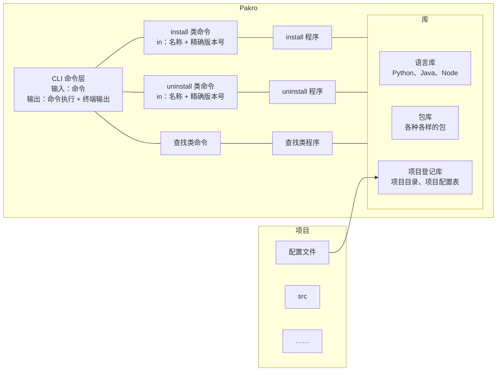
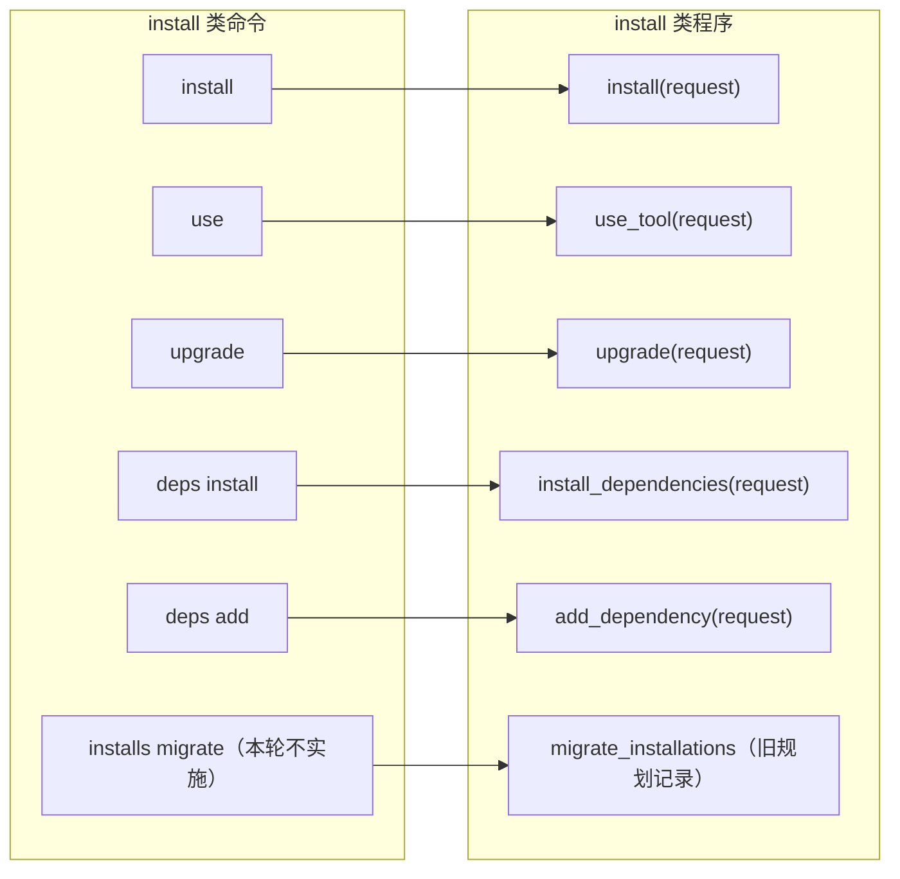
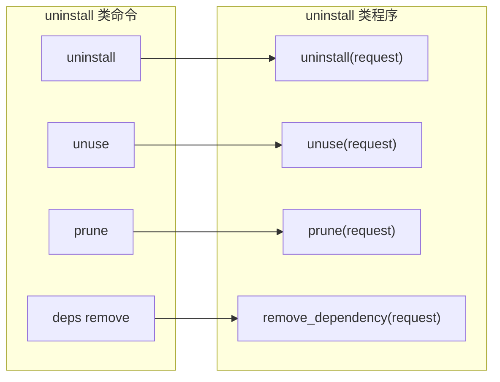
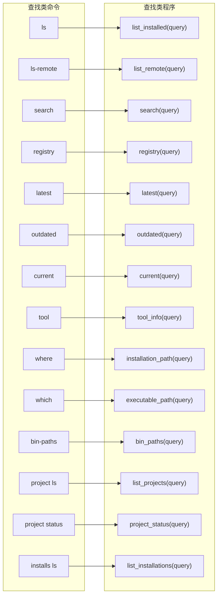
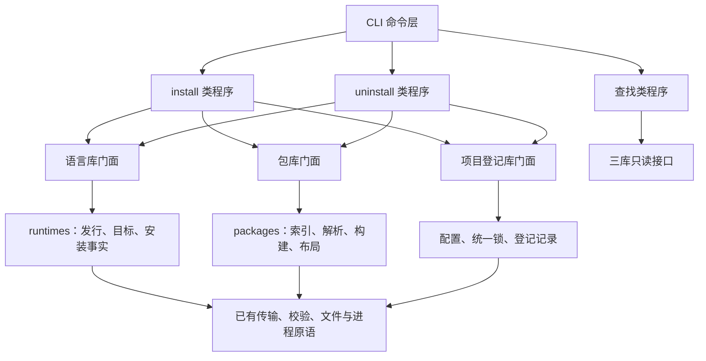
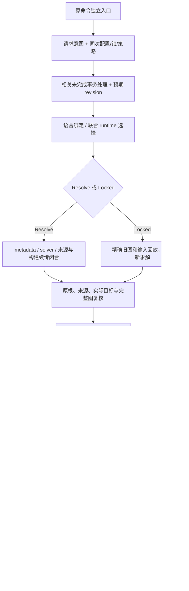

# Pakro 主架构文件与 Agent 规则

- 日期：2026-10-17。
- 设计者：用户。
- 来源：[用户手绘原图 IMG_1003.JPG](/Users/fuxinao/Downloads/IMG_1003.JPG)。
- 当前阶段：R00–R06 已完成并验证，历史证据保持。D07明确目录配置驱动选择，D08取消独立离线模式，统一为已有直接用、缺项由用户决定下载、没网明确报错；来源及凭证校验保留。当前只更新架构与计划，不改业务代码、不启动R07；后续编译、测试与检查由用户手动执行。
- 当前计划：用户要求更快看到可用成果，并明确将F4加入首版。PLAN现为“已有Python目录选择→显式安装缺项→真实wheel包使用→库内容/关联查询与指定删除”四阶段；D09规定有引用拒删，D10重申下载请求与项目直接清单必须写完整精确版本。原R00–R45详案已完整存档，长期功能没有被永久取消；当前只更新文档，不启动R07或F1–F4。
- 计划细化：按用户要求，当前PLAN已恢复逐文件修改/新增清单、接口交接、阶段边界、退役条件和手动验收合同；它细化F1–F4，不恢复原R00–R45全量前置。本文件给职责原则，准确文件范围及当前源码锚点以PLAN各阶段表为准。
- 本文件用途：集中记录用户的架构设计、核心需求、命令精简及程序模块对应关系。手绘图是总体结构，后续章节是本轮获授权的扩写稿；不表示这些结构和命令已经在代码中实现。

## 设计与修改权限

用户已明确接手整个 Pakro 架构的设计：**没有用户的明确命令，不得擅自修改现有架构和代码。**

1. 架构设计统一在本文件中进行，由用户决定和调整。执行依据为本文件及当前 [实施计划](docs/devlog/PLAN.md)；旧需求、旧架构和旧开发计划仅作为历史参考，不得据其扩大本轮范围。
2. 历史实施授权：用户此前要求“阅读……按照规则开始执行任务”，R00–R06已按后续指令完成。最新授权仅更新架构和PLAN，明确不改代码、不开始实现；不能沿用旧授权启动R07或F1–F4。未来获实施指令后，仍遵守当前任务范围与实际测试反馈。
3. 只修改当前任务列明的文件并同步开发记录。命令清单中的删除决定按对应任务和退出条件落实，不提前删除代码、配置或用户数据；R00 只建立基线，不开始业务重构。
4. 后文沿用现有命令逐项整理职责，函数名称表示目标逻辑入口；按计划逐项实现前，不声称已有同名接口，不擅自重命名或合并不同命令。
5. 图中的留白及未确定的技术方案继续由用户设计。不擅自调整架构、不修改任务范围外文件、不自动提交；终端任务按下节时限规则执行。

### 代码构建阶段与测试规则

最新覆盖规则（2026-10-18）：用户明确要求“先不要开启R07”和“后续编译和测试仍由我手动进行”。R06完成后不自动开始R07；后续编译、测试和检查交用户，除非用户再次明确调整授权。Agent依据实际日志确认结果，不因代码已写完就勾选验证通过。

1. **代码构建阶段必须使用 [dev-flow skill](/Users/fuxinao/.codex/skills/dev-flow/SKILL.md)**，按其流程进行计划、分步实现和审查，同时遵守本文件及用户的明确指令。
2. **此前Agent小范围验证授权（当前由上方用户手动规则覆盖）：每组命令上限20分钟（1200秒）。** 如用户未来重新授予Agent执行权限，该上限适用于必要的编译、检查、lint、单元测试及小范围脚本/harness；已知长任务交用户，不通过拆分或自动重试绕过时限。此处不构成当前测试授权。
3. 每组 Agent 执行的命令使用共同的墙钟时限并保存完整日志；超时停止本组及其子进程，只终止自己启动的进程，不碰其他任务。超时记录为“未完成，交用户”，不算行为失败、通过或零测试。交用户续跑时提供两项内容：
   - **现在要测试什么功能：** 必须用大白话说明要确认的实际行为。例如“看看 A、B 两个项目是不是共用同一份 Python，删除 A 后 B 还能不能正常用”，不能只报阶段编号、模块名或专业术语。
   - **测试命令是什么：** 给出可直接复制到终端的完整命令，包含必要的工作目录、参数和前置准备；只列本次功能验证需要的命令，不使用尚未实现的命令冒充可执行测试。
4. Agent 根据本次实际输出、退出码、用例数与跳过情况判断结果；长测试等待用户输出后再判断。没有实际结果不得声称验证通过。已通过且未变化的检查不无故重复。
5. 用户最新明确指令优先，当前编译、测试和检查由用户手动执行；dev-flow的测试先行与真实证据要求继续保留。历史执行授权及用户测试结果不改写。

长测试或超时后的手动测试交付统一使用以下格式：

> **现在要测试什么：** 用大白话说明本次要确认的功能行为。
>
> **测试命令：** 紧接可直接复制的命令代码块。

## 项目初心与本轮范围

Pakro 的初心是统一管理个人电脑中的 **语言、包、项目**。目标平台是 **Linux 和 macOS**，使开发者通过 Pakro 管理开发环境，不必为不同语言和项目分别下载、维护一堆管理工具。

| 管理对象 | 本轮关注的内容 |
| --- | --- |
| 语言 | 本轮只计划 Python、Java、Node 的具体版本和实际安装内容，依次实施。 |
| 包 | 各语言生态中的包、精确版本、依赖及适用的语言环境。 |
| 项目 | 项目目录、配置声明，以及项目与语言、包之间的关联。 |

主体仍是围绕这三个对象的 **install、uninstall、查找** 三类职责；用户已确认保留下文列明的缓存、诊断、环境信息和自身维护辅助入口。系统初始化、dotfiles、后台服务等虽曾被分入三类，但经用户明确选择，也不属于本轮核心范围。

**用户已确认的本轮范围与顺序：Python → Java → Node。先把 Python 的安装、包、项目关联、共享、恢复和卸载做完善并验收，再开始 Java，随后 Node。Go、Rust 及其他语言生态不安排本轮产品开发。Pakro 工程自身使用 Rust，以及 Python 扩展可能需要 Rust 编译工具，不等于增加 Rust 产品生态。**

**用户已取消 `install-into`。Pakro 自己下载和安装的语言、包及受管内容统一进入 Pakro 管理的库，不提供指定任意项目目录另装一套的命令。项目引用库内内容；必要临时文件和缓存也在 Pakro 受控存储范围内。**

这里的“开发环境”描述项目所使用的语言和包的组合，不因此另增一个管理对象或第四种库。它的具体表示、目录布局和持久化方式由用户后续设计。

## D07：项目目录驱动选择，缺项由用户决定安装

2026-10-18用户纠正使用主线，并明确确认“允许必要内部适配，不增加用户操作步骤”。本节优先于后文将内部布局误解为独立环境管理步骤的表述，不表示本次已完成接线。

1. 用户进入项目目录，Pakro按既有配置发现规则读取该项目配置及适用的锁定信息，查找语言库和包库中已安装、可用且匹配的内容。
2. 内容已存在就直接选用；不要求用户先创建、命名、登记或逐项目激活一个独立虚拟环境。项目目录仍保存源码和声明，实际语言和包继续由库管理。
3. 发现缺失时列出缺少的语言/包，由用户决定是否下载安装。仅进入目录、查询路径、输出环境信息或找不到命令，都不能作为下载、升级或补装的授权；未选择安装就不执行安装。提示形式后续接线时细化，不把未回答当同意。
4. 用户主动执行install/use/deps等已有安装意图，或明确选择安装缺项后，才调用统一安装程序；该明确意图无需再对每个制品重复确认。必要依赖仍随授权的安装处理，成功后按同一份项目配置重新选择库中内容。
5. 允许Pakro在受控存储内生成必要的包路径、启动配置或轻量链接，保持真实包导入、脚本及原生扩展语义。这些只是内部适配，自动复用已有结果，不成为新的用户管理对象、额外命令或每项目完整Python副本。具体采用何种路径/链接/启动机制仍需按生态细化，不能仅凭此条锁定venv、PYTHONPATH或某一机制。
6. 相同实际语言和兼容包仍共享；不同项目的包选择不混入共用Python的全局site-packages，A修改配置不会改变B选择。必要的配置观测、精确身份、锁、引用及来源校验继续保留。
7. 目录感知的最小终端接入属于核心使用流程，应复用旧配置发现、工具选择及环境差异应用能力。不能把这些必要部分随通用Shell会话、任务、daemon功能整组删除；也不因此恢复所有旧Shell/任务功能。VSCode接入及外部进程完整生命周期保护仍按D03后置。

使用顺序：进入目录 → 读取配置 → 查已有语言/包 → 已齐全则直接选用；缺项则提示 → 用户选择是否安装 → 获明确安装意图后获取缺项 → 回到选择。进入目录的选择路径不进入后文安装/构建/提交的完整流水线。

## D08：不单独提供离线模式，按实际使用和下载意图处理

2026-10-18用户明确决定：“已有直接用、缺项由用户决定下载、没网明确报错”，来源和凭证校验保留。本节取代此前将Offline列为独立产品模式及验收目标的安排。

- 库内已有完整、兼容且校验有效的语言/包时直接使用，不因启动项目而访问远端。已有合法缓存可正常复用；损坏或未完成内容不能冒充已有可用安装。
- 缺项时说明缺少什么，用户决定是否下载；没有明确安装意图就不获取缺项、不刷新下载凭证。用户主动执行已有安装命令即属于明确意图，不再逐依赖重复确认。
- 已获安装意图且确需网络时，按本次指定来源和凭证获取；连接失败、超时等如实报错，认证/授权错误不伪装成“没网”或“没有版本”。不切换版本/来源来掩盖失败，不破坏已发布内容或旧项目选择。
- 不新增独立离线开关、离线工作流或连通性管理子系统，也不要求用户切换模式才能使用已有内容。网络请求是否合适取决于当前操作：本地选择/查询不联网，用户明确请求远端搜索或版本信息则可访问来源，失败同样明确报告，不顺带安装。
- 来源授权、registry/CDN凭证边界、逐跳重定向校验、缓存权限范围、摘要校验及原请求期限继续保留。构建worker只消费准备好的输入、不自行获取依赖等内部隔离仍有效；这些不是用户需要选择的离线模式。
- 本次只修改架构和计划。现存offline代码字段、旧测试和历史结果不在本次删除或改写；未来接线时核对相关消费者，不能因字段仍存在就继续扩建已取消的产品模式。

## D09：首版包含库内容、关联查询和指定删除

2026-10-18用户明确将F4加入首版：能查询库里的项目、语言、包及它们的关联，也能删除指定语言和包；有项目或依赖在用就列出来并拒绝删除，没有引用才允许删除。这里只确定目标行为，尚未开始实现。

- 查询范围是Pakro已登记/关联的项目和受管库：项目位置及其语言/包，语言/包的完整版本与实际实例，以及项目和包之间的直接、间接依赖。可以从对象反查使用者，不只检查当前目录，也不扫描整台电脑猜项目。
- F1–F3在成功选用/安装时同步维护最低持久关联：项目→精确语言/包、包→实际依赖、内部适配→语言。内部登记不增加用户步骤；只读查询不登记或修复。退出目录只撤当前终端选择，不解除项目持久引用；新选择成功后才更新关联。
- 指定删除沿用uninstall职责。按完整版本及实际实例选定唯一目标；同版本多构建/变体不任取。有项目、保留的包或其他依赖引用时，列出使用者和引用链并拒绝；不能偷偷改配置、解除关联或连带删依赖来让目标变成“无引用”。
- 没有引用是删除的必要条件。删除与新增引用共用实际对象保护，取得排他保护后再核对最新引用和对象身份；Pakro内部仍在使用时不能删除。登记损坏、项目暂不可访问等导致无法确认时，保留已知引用并报告受影响范围，不能当成零引用。
- 只删除用户本次明确指定的语言/包，其他内容不变。部分删除失败如实报告，不把半成品继续列为可用；最低关联记录与实际写入保护必须随首版完成。批量prune、强制变更、完整回收/恢复矩阵继续后置，不成为F4的额外功能。
- 外部进程完整生命周期仍按D03后置；F4不声称已追踪任意外部启动的解释器。查询命令沿用原职责，包级参数在接线时明确，不凭对象类别发明一套新CLI。

## D10：用户下载请求与项目清单必须使用完整精确版本

2026-10-18用户重申此前要求：任何下载目标都要精确到具体版本，下载命令或项目环境清单不能写模糊版本。以下约束贯穿F1–F4及后续支持的生态，不因快速交付而省略。

- 用户指定的语言和直接依赖必须是该生态的完整发行版本。Python须写到补丁号，例如`3.11.14`；`3.11`、`3`、`3.11.*`、版本范围、`latest`或浮动别名不能自动补成某个版本。用户示例中的`xx`代表真实补丁号，字面值`3.11.xx`不是合法下载版本。
- 安装命令可从项目配置读取已经明确的完整版本；参数和配置都没有完整版本时，先报错提示补齐，在远端获取、下载和业务写入前拒绝。目录选择同样不能将不完整声明猜成已安装的某个版本，即使当前只有一个候选。
- 包的完整版本遵循真实上游发行号，不要求所有生态都强行三段，也不通过补零制造版本。今后的upgrade/use/deps add等下载或更新入口也遵守此要求；latest/ls-remote等查询仍可帮助发现候选，但查询结果不自动授权安装或替换声明。
- 包作者metadata里的传递依赖范围仍需真实解析；不要求用户手填所有间接依赖。每个实际语言/包制品下载前先确定精确版本和制品，下载后完成校验并保存实际结果；已知来源/摘要pin必须遵守。完整可移植锁可以后置，最低精确结果和真实依赖关联不能后置。
- 完整版本仍须结合发行build、平台、ABI、来源及制品摘要区分实际对象；版本相同不代表内容一定相同。用户不必手填所有内部身份字段，遇到无法唯一确定的实例则列明候选，不能偷偷选最新构建或任取一个。

## 首版实施边界：把F1–F4落实到已有代码

此节是D07–D10的实施细化，不增加新的产品阶段。逐文件清单和验收见[当前PLAN](docs/devlog/PLAN.md)，以下限制同时约束后文长期目标接口。

1. **F1先支持真实的仅语言选择。** 当前ProjectSelections只是CatalogModel纯门面，不能当持久登记。先在同一模型中明确仅语言选择与包布局选择的区别，记录项目身份/位置、声明观测、精确LanguageKey及实际Ready发布事实；没有包布局时不能伪造graph、receipt或allocation。F3才加入真实包布局及依赖图。
2. **只读查询与目录应用分开。** `programs/query/{snapshot,paths}.rs`生成选择描述；`programs/install/selection.rs`只负责已有内容的关联应用，不获取缺项。hook在关联成功后输出新路径；env及查询仍只读。应用按项目→对象→catalog的锁顺序重取并复核保护，不持query的对象锁反向取得项目锁。
3. **登记只有一个权威。** `libraries/project/{identity,location,repository,read_views}.rs`复用原CatalogModel、codec和R05 IO；`programs/shared/commit.rs`先只提交一个内部catalog中的登记/选择。查询不open_writer，不让projects.json或另建refs表决定删除。此处不同时创建完整`shared/commit/` WAL目录；未来确需多文档事务再扩。
4. **F2复用R06，不沿用模糊选择。** 真实CLI在旧迁移、任务收集、版本补全及写入前分流；Python native现有choose_release自动取较新发行build的行为须在新路径纠正。旧强制改写/删除在首个副作用前经同一保守拒绝门，不等F4才保护已发布对象。
5. **F3复用协议核，改共享接缝。** VerifiedArtifact、registry闭包、wheel校验/安装和目标探测保持唯一实现；新路径持实际LanguageLease，退出完整runtime复制。精确包节点、来源pin、真实依赖边及layout关联进入同一catalog；图摘要不能代替依赖边。实际对象保护覆盖关联提交，跨阶段重取须遵守原锁顺序并复核。目录选择同时接入已发布包组合；内部路径/链接适配必须有真实导入和入口证据，不能只因设置PYTHONPATH就宣布完成。
6. **F4只接本地视图和指定删除。** 查询读同一权威和真实对象；指定删除取得私有许可、复核引用及身份再删除。旧暂存cleanup的权限不能用于正式已发布对象，稳定锁不能随内容删除。完成该对象删除所需的状态处理保留，批量prune、项目声明编辑、全库恢复及强制删除继续后移。

默认不删除源文件。只有本阶段真实消费者已替代、用户验收有证据，才局部退出重复调用或正文；未迁移生态、原解析/IO核和有价值测试保留。所有编译、测试和检查继续由用户手动执行，当前文档完善不授予实施许可。

## 重点需求：多个项目共用一份实际环境内容

### 共享原则

- 同一份实际语言安装在电脑中只存储一份。项目 A、B 使用同一个 Python 3.11.14 实例时，二者引用语言库中的同一份 Python，而不是各自复制一套解释器和标准库。
- 项目各自保留配置和依赖选择。项目不同，不应成为重复下载、安装相同语言内容的理由。
- 包也应尽可能共享：精确包制品和适用条件相同的内容复用一份；不能只凭名称、版本相同就忽略不同平台、ABI 或构建结果的差异。
- 项目包在包库中准备，由项目选择使用；不能为了给 A 添加依赖而修改 A、B 共用的语言安装，使 B 的可见包集合也随之改变。
- 语言和全部包组合相同时，不因项目目录不同而再保存一整套相同内容。依赖组合不同时，共享相同的组成部分，不强行把不同依赖组合混为一个环境。
- 一个项目改变语言版本或依赖，应准备所需的新对象并调整该项目关联，不能原地改坏其他项目正在使用的共享内容。
- 项目解除关联后，只释放该项目的引用。仍被其他项目直接或间接引用，或仍由 Pakro 内部安装、构建和恢复操作持有的内容必须保留。IDE/外部直接运行的生命周期接入按 D03 后置，不声明已经覆盖。
- 不自动附带常用包，不把旧默认包清单自动转换成项目声明。只安装用户明确选择的包及其必要依赖。
- 只有用户显式执行 `pakro prune` 才批量清理无项目引用的正式内容；提前手动安装不形成额外永久保留理由。安装、升级或解除关联不暗中触发全库 prune；本次操作自己的失败暂存、事务收尾可按所有权规则清理。

“同一份”的判断至少需要区分完整版本、发行或构建、目标平台和兼容条件。原手绘图中的 Python 3.11 是共享示意的简写，不是合法的下载/项目声明；实际输入遵守D10，完整身份沿用下文LanguageKey等模型。不能将不兼容的两份内容误合并，也不能为每个项目人为制造不同身份来规避共享要求。

### A、B 项目的预期结果

| 场景 | 预期结果 |
| --- | --- |
| A 首次需要某个精确 Python 3.11.14 安装 | 语言库准备一份实际安装，A 引用它。 |
| B 随后需要同一份 Python 3.11.14 | 检查并复用已存在的安装，B 不再保存第二套解释器和标准库。 |
| A、B 使用不同包集合 | 各自记录依赖选择，仍共享同一份 Python；相同且兼容的包内容继续复用。 |
| A 改用另一个精确 Python 版本 | A 关联新版本，B 继续使用原来的 Python 3.11.14。 |
| A 解除项目关联 | B 的语言和包不受影响。 |
| 请求删除 B 仍使用的 Python 3.11.14 | 拒绝物理删除，并说明仍有谁在引用。 |

具体采用链接、引用文件还是其他机制，本轮不确定；“只存一份”必须落实到实际内容，不能只是在界面上显示一条记录。

## 架构图




## 命令整理规则：分类不等于合并

三类程序是三个抽象模块，**不是每类只能有三个命令，也不是“类别 × 对象”的命令数量限制**。每类可以包含多个不同职责的命令，并分别对应程序入口函数。

此前把现有命令改写成 `install language/package/project`、`uninstall language/package/project` 和 `find language/package/project` 的方案属于 Agent 过度重设计，已撤回。这些新拼写及其参数不作为本架构的决定。

本轮整理遵循：

1. 从此前列出的现有命令出发，保留“语言、包、项目”范围内的独立职责，不重新发明一套统一命令。
2. 只把同义别名、同一处理逻辑的重复路径和父命令的默认转发视为确定重复。
3. 输入、操作对象、副作用或输出契约不同的命令，不能仅因属于同一类或复用底层代码就合并。
4. 系统初始化、dotfiles、后台服务等，按照用户此前确认的“只保留语言、包、项目核心管理”范围排除；这是范围裁剪，不是去重。
5. 与共享原则存在冲突或范围尚不明确的命令，保留条目并说明待定点，不擅自判定删除。
6. 命令与函数的一一对应，以独立业务命令为单位；别名不增加入口函数，内部公共过程允许复用。

以下函数名称只表达拟归属的逻辑入口，不声称当前源码已有同名函数，也不确定新的 Rust 文件或 crate 划分。命令名沿用现有入口；具体参数及其在重构后的行为由用户继续设计。

## 可以确定去重的入口

| 现有重复形式 | 架构中只保留的名称 | 去重依据 |
| --- | --- | --- |
| `install` / `i` | `install` | 同一命令的别名。 |
| `use` / `u` | `use` | 同一命令的别名。 |
| `upgrade` / `up` | `upgrade` | 同一命令的别名。 |
| `unuse` / `rm` / `remove` | `unuse` | 同一命令的别名。 |
| `ls` / `list` | `ls` | 同一命令的别名。 |
| `ls-remote` / `list-all` / `list-remote` | `ls-remote` | 同一命令的别名。 |
| `installs ls` / `installs list` | `installs ls` | 同一子命令的别名。 |
| `deps` / `dep` / `prepare` | 使用完整的 `deps <子命令>` 表达业务操作。 | 父命令的别名不是新的业务功能。 |
| 裸 `deps` 默认执行依赖安装 | `deps install` | 默认分派，不另设一套安装函数。 |
| 裸 `installs` 默认列出安装实例 | `installs ls` | 默认分派，不另设一套查询函数。 |

“只保留名称”指架构清单不重复列出别名，当前代码没有被删除。以后是否继续接受兼容拼写，由用户决定。

## install 类命令与 install 类程序扩写

### 独立命令与对应函数

| 命令 | install 类程序中的逻辑入口 | 独立职责 | 与其他命令的区别 |
| --- | --- | --- | --- |
| `pakro install` | `install_program::install(request)` | 安装指定的语言、工具或配置声明中的对象，包含原有的包绑定安装意图。 | 安装本身不等于允许改写项目声明或自动升级。 |
| `pakro use` | `install_program::use_tool(request)` | 安装所需对象，并将选择写入相应配置或项目关联。 | 比 install 多了明确的配置和选择变更，不能直接删除。 |
| `pakro upgrade` | `install_program::upgrade(request)` | 按明确的完整目标版本准备更新，并处理有关的配置、锁和关联。 | 升级不是普通缺失项安装；遵守D10，不把“升级”解释为自动选择最新版本。 |
| `pakro deps install` | `install_program::install_dependencies(request)` | 为项目准备其声明的依赖集合。 | 操作的是项目依赖集合，不只是某个语言实例。 |
| `pakro deps add` | `install_program::add_dependency(request)` | 为项目添加依赖声明并准备相应依赖。 | 修改声明与仅安装已有声明不同。 |
| `pakro installs migrate`（本轮不实施） | `install_program::migrate_installations(request)`（旧规划记录） | 原职责是迁移旧布局中的安装。 | D02 已选择清理旧测试安装，不开发旧数据迁移；此行不授权新增迁移模块或删除旧入口。 |

`install-into` 已由用户明确取消。D02 已决定旧 Pakro 安装是无用测试数据，清理而不迁移；`installs migrate` 保留在这里作为旧入口记录，本轮不扩建、不接管旧测试数据，也不作为验收前置。用户尚未单独要求删除这个命令，因此不借清理旧数据顺手删除其现有代码。

现有 `deps` 会委托其他包管理器。保留其“项目依赖安装、添加”的命令职责，不等于认定现有实现已经满足统一管理、共享或原生管理要求。

### 对应关系图



### 模块共同遵守的边界

- 不同命令保持各自的输入、配置变更和输出含义，不以“都要下载”为由合并。
- 下载请求及项目直接声明按D10先验证完整精确版本；不靠远端搜索或本地候选自动补全。
- 准备对象前先检查共享库，已有同一份可用内容时复用；多个项目同时请求也不能各自保存一套相同语言安装。
- use、upgrade 或 deps add 改变一个项目的选择时，不能原地破坏其他项目共用的语言或包。
- 公共的来源识别、获取、校验、依赖处理、存储复用和引用维护可以共享；入口独立不要求底层代码重复。
- 具体下载器、解析器、并发机制及文件布局由用户继续设计。

## uninstall 类命令与 uninstall 类程序扩写

### 独立命令与对应函数

| 命令 | uninstall 类程序中的逻辑入口 | 独立职责 | 与其他命令的区别 |
| --- | --- | --- | --- |
| `pakro uninstall` | `uninstall_program::uninstall(request)` | 删除明确指定的已安装对象。 | 针对实际安装内容，不等于删除项目声明。 |
| `pakro unuse` | `uninstall_program::unuse(request)` | 移除工具声明或项目选择，并处理不再需要的关联。 | 先改变声明/关联；共享内容是否可删除必须另行检查。 |
| `pakro prune` | `uninstall_program::prune(request)` | 查找并清理不再需要的安装对象。 | 先计算可回收集合，不是按用户给定名称直接卸载。 |
| `pakro deps remove` | `uninstall_program::remove_dependency(request)` | 从项目移除依赖声明，并处理依赖关系变化。 | 针对项目依赖；不能直接等同于删除全局包实体。 |

这里保留 prune 的长期核心无用安装清理职责；首版F4只开放受引用保护的指定语言/包删除，批量prune及自动编辑声明仍按PLAN后移。旧命令中其他配置清理选项的范围不自动继承，仍由用户明确。

### 对应关系图



### 模块共同遵守的边界

- 项目解除关联与共享实体物理删除是两种行为，不因同属 uninstall 类就视为相同。
- 在物理删除前检查其他项目、传递依赖以及正在使用或准备对象的操作；仍有使用者时必须保留。
- 移除一个根依赖时，不能把仍被其他依赖需要的包一起删掉。
- 用户显式执行 prune 时，筛选无任何项目直接或间接引用的受管内容；不因曾经手动安装而保留。unuse、deps remove 先解除关联，不暗中运行全库 prune。活跃内部操作和未完成恢复仍有临时保护，不能把未知状态当成零引用。
- 本轮未新增“注销项目”或“删除项目源码”的命令。项目登记的完整删除流程若需要补充，由用户设计，不再擅自用 `uninstall project` 代替。

## 查找类命令与查找类程序扩写

查找类是程序模块的类别名称，**不等于必须新增一个名为 find 的统一 CLI 命令**。原有查询各有对象、范围或输出差异，分别保留入口。

### 独立命令与对应函数

| 命令 | 查找类程序中的逻辑入口 | 独立查询内容 | 不能直接视为重复的原因 |
| --- | --- | --- | --- |
| `pakro ls` | `query_program::list_installed(query)` | 本地已安装及配置涉及的版本。 | 是本地安装与配置视图，不是远端版本清单。 |
| `pakro ls-remote` | `query_program::list_remote(query)` | 远端可获取的版本。 | 来源与 ls 不同。 |
| `pakro search` | `query_program::search(query)` | 按名称或条件发现可管理的语言/工具。 | 查找名称，不是列出某个名称的所有版本。 |
| `pakro registry` | `query_program::registry(query)` | 已知简称与安装来源/后端的映射。 | 查看映射关系，不等同于搜索结果或版本列表。 |
| `pakro latest` | `query_program::latest(query)` | 一个请求匹配的最新候选版本。 | 输出候选结果，不进行当前版本差异比较。 |
| `pakro outdated` | `query_program::outdated(query)` | 当前选择与更新候选之间的差异。 | 是比较查询，不等同于 latest。 |
| `pakro current` | `query_program::current(query)` | 当前配置生效的运行时选择及其安装状态，保留既有简洁输出用途。 | 与 ls 有信息重叠，但展示和脚本输出契约不同，不凭重叠直接删除。 |
| `pakro tool` | `query_program::tool_info(query)` | 某个语言/工具的综合详情。 | 详情查询不是名称搜索或简单版本列表。 |
| `pakro where` | `query_program::installation_path(query)` | 安装根目录。 | 安装目录不是可执行文件路径。 |
| `pakro which` | `query_program::executable_path(query)` | 某个可执行文件最终解析到的路径。 | 一个安装可以提供多个可执行文件。 |
| `pakro bin-paths` | `query_program::bin_paths(query)` | 当前运行时提供的 bin 目录集合。 | 查询集合与 where、which 的单项含义不同。 |
| `pakro project ls` | `query_program::list_projects(query)` | 本机登记的项目列表。 | 多项目列表，不等同于一个项目的状态。 |
| `pakro project status` | `query_program::project_status(query)` | 当前项目的配置、语言、包及准备状态。 | 项目详情包含声明、关联和缺失情况。 |
| `pakro installs ls` | `query_program::list_installations(query)` | 独立安装实例及其选择、锁定或共享状态。 | 同版本可有不同实际安装身份，粒度不同于普通 ls；新身份表示待用户设计。 |

表中保留的是现有查询职责。D09已确定首版必须能查库内项目、语言、包及其关联；包级参数及输出在接线时明确，不能将功能范围继续列为待定，也不凭空补入统一find接口。现有search、registry等主要面向工具，本地包查询不等于已经支持所有语言生态的远端包搜索。

### 对应关系图



### 模块共同遵守的边界

- 本地查询、远端发现、项目选择和全局已安装状态分别说明，不能把它们混成一个列表。
- 终端可以复用输出组件，程序可以复用查询内核，但不因此删除不同查询职责。
- 查询不因发现缺失或新版就擅自安装、升级或切换项目关联。
- 原有命令的隐式安装、联网或诊断执行行为需在重构时单独审查；不能仅凭归入查找类就声称当前实现完全无副作用。
- 返回结构、筛选参数和输出格式由用户后续设计，不在本轮自创一套通用视图参数。

## 范围裁剪与待定项

### 按用户已确认的范围排除

以下功能不是因为“命令重复”而删除，而是因为本轮只设计语言、包、项目核心管理：

- 系统初始化与宿主管理：bootstrap 中的账户、系统包、服务、防火墙、Compose、仓库同步、系统偏好和远程初始化。
- dotfiles 及其历史、同步、回滚：包括其中原先分入下载、删除、查找类的命令。
- 后台服务、容器、独立插件/后端管理、凭证、skills 和宣传信息等非核心功能。
- 上一轮无法归入三类的通用任务执行、独立Shell会话、远程执行、MCP、文件生成、通用配置编辑等独立命令，本轮不继续设计。D07所需目录感知、既有内容选择及最小终端接入不在整组退出范围内，必要部分须先保留/拆分。
- 项目源码骨架生成、旧内部协议入口等不因命令整理而重新加入。

这不等于删除内部必要能力。获取校验、依赖解析、来源适配、缓存、精确结果记录、项目登记和引用保护仍可能是三类程序的内部需要，具体方案由用户决定。

### 不应擅自当成重复项删除的边界

| 命令或问题 | 当前记录方式 |
| --- | --- |
| `install-into` | 已取消，不再是待定项；所有受管下载和安装统一进入 Pakro 库。后续实施时移除旧入口，本次不动代码。 |
| `installs migrate`、`installs ls` | 旧测试数据不迁移，本轮不扩建 migrate；实例查询 ls 保留。清理数据与删除命令是两件事。 |
| `installs select` | 已确认保留：选择已有安装实例，复用统一选择记录和提交边界，不复制实际内容。 |
| `cache clear/prune/path` | 已确认保留：清空可丢弃缓存、按过期策略清缓存、显示缓存位置；不卸载正式语言和包，不与顶层 prune 合并。`cache task` 及任务专属选项仍随非核心任务范围排除。 |
| `doctor`、`doctor path`、`doctor project`、`test-tool` | 已确认保留。诊断和实际执行检查分清；涉及准备安装时走同一程序层，不绕过三库。测试按小范围 Agent 执行、长任务交用户的时限规则进行。 |
| `env` | 已确认保留：按同一项目快照输出已有内容对应的环境变量与路径。依D07，缺项先报告，不因旧自动安装设置而静默补装；只有用户另有明确安装意图才交统一install。保留env不意味着编辑器接入已完成。 |
| `version`、`self-update`、`implode` | 已确认保留 Pakro 自身维护职责，复用原实现。self-update 的发行配置缺口如实报告；implode 仅在用户显式调用时按实际范围处理，不由普通安装/查询触发。 |
| 库内包查询与关联、项目登记/解除登记 | D09已将本地项目/语言/包及关联查询纳入F4，F1–F3内部维护必要登记；具体包级参数与额外登记/解除登记命令仍须明确，不机械生成新命令，也不冒称已经实现。 |

## 命令层、程序层与库的关系

- CLI 命令层负责各命令参数、请求转交及终端输出。
- 三类程序模块各自包含多项独立业务入口；每条保留命令对应自己的逻辑入口函数。
- 语言、包、项目是处理对象，不是命令数量的计算公式。
- 底层过程可以共享，语言和包的实际内容也按共享规则复用；这两种复用都不意味着用户命令可以无条件合并。
- 当前代码未改动。本文件中的函数归属、共享行为和未决项仍是设计内容，是否实施由用户另行下令。

## 代码级架构细化：沿用整体结构，展开模块内部

本章依据用户本轮授权，参考旧详细架构与当前源码，细化前述三类程序和三种库。**整体架构图、命令清单及命令与入口函数的对应关系不变**；不新增公开命令，不把不同命令再合并成少数入口。本章中的目录、类型和接口是目标设计，没有创建相应文件或完成代码迁移。

为避免混淆，以下采用三种表述：**现有资产**表示源码中已有可检查的实现；**目标接口**表示重构后需要满足的合同；**待定产品边界**保留用户尚未决定的行为。旧计划中的完成标记不作为本轮实现或验证证据。

### 1. 参考来源与取舍

| 档案 | 本章吸收的细节 | 不照搬的内容 |
| --- | --- | --- |
| [原包管理详细设计](/Users/fuxinao/文件/project/pakro/docs/devlog/pakro-包管理架构设计.md) | 纯解析器、索引与存储分离；精确直接依赖与传递依赖求解；语言/包/项目关联。 | 语言身份只有名称版本、wheel 只需解压、按项目物化的旧默认规则，以及旧 store/init/attach 命令。 |
| [旧方案 B](/Users/fuxinao/文件/project/pakro/docs/devlog/proposals/pakro/ARCHITECTURE.md) | 不可变上下文、原生适配器、固定输入构建、统一锁、可恢复事务、生态差异。 | 旧公开命令、新 crate 数量、旧目录重组、非核心扩展，以及含 ProjectId 的共享内容身份。 |
| [Python 详细规格](/Users/fuxinao/文件/project/pakro/docs/devlog/proposals/python-native/SPEC.md) | 真实目标、来源、wheel、源码、editable、Conda、锁定与验证边界。 | 旧离线产品模式按D08取消；已退出的Shell/task等入口和历史进度不作为当前能力。 |
| [来源与索引计划](/Users/fuxinao/文件/project/pakro/docs/devlog/proposals/python-native/H3a-SIMPLE-SOURCES-PLAN.md)、[求解协调计划](/Users/fuxinao/文件/project/pakro/docs/devlog/proposals/python-native/H3d6-REGISTRY-DEPOT-PLAN.md) | 来源身份、认证、缓存、元数据与精确制品绑定、按需求解。 | 任意元数据对象自动取得安装权限，或通过旧全局配置绕开本次上下文。 |
| [环境事务计划](/Users/fuxinao/文件/project/pakro/docs/devlog/proposals/python-native/H2e-TRANSACTIONS-PLAN.md)、[运行时生命周期审查](/Users/fuxinao/文件/project/pakro/docs/devlog/proposals/python-native/H2e5-RUNTIME-LIFECYCLE-REVIEW.md) | catalog、journal、持久锁、引用保护、失败恢复、删除边界。 | 每项目独占完整运行时副本、generation 只能绑定一个项目，以及查询时自动写盘恢复。 |
| [锁模型计划](/Users/fuxinao/文件/project/pakro/docs/devlog/proposals/python-native/H3l-LOCK-MODEL-PLAN.md)、[配置来源计划](/Users/fuxinao/文件/project/pakro/docs/devlog/proposals/python-native/H3p5-NATIVE-CONFIG-SOURCE-PLAN.md) | 原始声明、来源、精确图、同次文件观测、配置与锁的变更检测。 | 把缓存 Config 与新读文件拼成一致快照，或把锁模型序列化等同于完整发布。 |

沿用当前 Rust 工程及已有协议/算法资产。本轮不新增数据库、常驻服务、RPC 层或独立 crate。先完成 Python，再完成 Java，最后 Node；各自保留自己的版本、图和布局语义，不通过复制 Python 实现宣称支持。其他生态既有代码按可复用资产保留，不因暂不计划就立即删除。

### 2. 代码落位与依赖方向

保留现有七个根职责目录。以下是**拟新增或拆分的内部模块落位**，不是本次执行文件迁移：

```text
cli/src/commands/                 # 现有命令：参数、别名、展示、退出码
src/core/programs/               # 拟定：三个程序的应用编排
  install/
    mod.rs                       # 5 个本轮安装入口；旧 migrate 记录不扩建
    request.rs                   # 意图与请求校验
    context.rs                   # 配置/锁/策略快照
    plan.rs                      # 变更计划、保留/更新范围
    runtime.rs                   # 语言实例选择与共享复用
    resolve.rs                   # 元数据—求解协调
    acquire.rs                   # 原始制品获取与验证
    build.rs                     # 元数据观测与源码构建协调
    layout.rs                    # 包布局计划与构造
    verify.rs                    # 完整结果核验
    apply.rs                     # 驱动准备和统一提交
    # migration.rs 不在本轮新增；D02 选择清理旧测试安装
  uninstall/
    mod.rs                       # 前文 4 个独立入口
    select.rs                    # 删除目标及清理候选
    project_edit.rs              # 解除声明、重新求图
    reachability.rs              # 传递引用与保留集合
    plan.rs                      # 删除计划及阻止原因
    reclaim.rs                   # 受保护的物理回收
  query/
    mod.rs                       # 前文 14 个独立入口
    snapshot.rs                  # 一致只读视图
    inventory.rs                 # 已安装、当前选择、实例详情
    discovery.rs                 # 来源、搜索、远端版本
    comparison.rs                # 最新候选与当前版本比较
    paths.rs                     # 安装根、可执行文件、bin 目录
    projects.rs                  # 项目列表与状态
    report.rs                    # 结构化查询结果
  shared/
    types.rs                     # 请求、结果及纯数据类型
    policy.rs                    # locked/本次操作授权/预算/变更权限
    commit.rs                    # 配置、锁、登记状态的联合提交
    errors.rs                    # 分阶段结构化错误
src/core/libraries/              # 拟定：图中三种库的访问门面
  language/                     # 语言实例、清单、租约、删除许可
  package/                      # 制品、展开内容、构建结果、共享组合
  project/                      # 项目身份、声明快照、关联、引用
runtimes/src/                    # 复用/改造：发行源、目标探测、安装布局
packages/src/                    # 复用/改造：生态协议、构建和布局内核
packages/crates/pakro-index/     # 元数据、来源协议、获取策略
packages/crates/pakro-resolver/  # 纯版本与图求解
packages/crates/pakro-store/     # 内容、受控落盘及回收原语
src/core/config/                # 原配置解析与单次观测能力
src/core/lockfile/              # 原锁文档、保真读写和文件保护能力
src/core/artifact_snapshot/     # 已校验制品与缓存访问能力
```

`shared` 只是三类程序共用的内部类型和事务协调，不是第四类程序；三个库门面也不复制现有协议实现。程序通过门面取得持有者或操作结果，复杂算法仍由现有深层模块承担。

依赖方向必须明确：



- 核心不反向调用 CLI、不直接打印、不重新读取全局参数；CLI 接收结构化结果后输出。
- resolver 不读磁盘、不联网、不启动进程；index 不写项目选择；构建 worker 不求解或安装依赖。
- query 只能取得读接口，不能拿到 install 的发布句柄或 uninstall 的删除许可。
- 语言库不依赖项目路径决定内容身份；项目登记库通过引用关联对象，不成为另一套语言/包存储。
- 同一个输入事实、文件打开核、哈希核和锁协议只保留一个实现，命令层不各自复制。

### 3. 公共数据类型与身份

下表规定字段含义，不冻结最终序列化语法。文件句柄、租约、密钥和本机路径不能混入可移植锁数据。

| 类型 | 必需内容 | 所有权与限制 |
| --- | --- | --- |
| `OperationContext` | 本次设置快照、允许来源、目标事实、绝对截止时间、取消信号、资源预算、执行策略。 | 单次调用构造，下层不自行刷新 deadline 或放宽权限。 |
| `ProjectSnapshot` | 项目身份/位置、全部参与配置及优先级、原始声明与来源位置、锁快照、选择 revision。 | 必须来自同次真实观测；缓存解析值不能冒充当前文件。 |
| `DeclarationSet` | 显式根依赖、语言绑定、extras/groups、原始声明位置、来源绑定。 | 根不能由“入度为零”推断；重复声明和未激活条件仍需可追溯。 |
| `TargetFacts` | OS/架构/libc、语言实现和完整版本、ABI/组件、有序制品兼容标签。 | 记录观测来源；未知事实不能用宿主猜测填满。 |
| `SourceIdentity` | 注册表或直接来源、精确 revision/子目录、逻辑源标识及信任要求。 | 可移植身份不含 secret；本地路径绑定单独保存。 |
| `LanguageKey` | 实现、精确发行/版本、平台/ABI、制品或固定构建输入、安装配方版本。 | 不含 ProjectId；同键对应全局一次已发布的实际安装。完整 inventory 另由 manifest 证明。 |
| `ArtifactId` | 原始字节的摘要算法和摘要。 | 摘要证明字节，不自动证明来源授权、兼容性或安装完整。 |
| `PackageInstanceId` | 生态、规范名、精确版本、来源、角色、目标及依赖上下文。 | 同名不同版本/peer context 可同时存在；内容 blob 可进一步共享。 |
| `BuildRequestId` | 已固定源码、构建依赖、host/target、编译器、配置与配方。 | 是输入身份，不是尚未产生的输出摘要。 |
| `BuildReceipt` | 实际输出摘要、metadata、工具与输入身份、构建结果。 | 不假定相同源码输入天然可重复构建。 |
| `SharedLayoutKey` | 语言实例、闭合包图、固定构建请求、目标与布局配方。 | 不含 ProjectId；决定共享组合候选和最终前缀分配。实际输出、目录与校验事实在 receipt 中记录。 |
| `ProjectSelection` | ProjectId、声明组、目标、仅语言或真实包布局选择、精确引用、revision、事务编号。 | 项目各自持有，不能把它与共享内容身份混为一体；F1仅语言分支不伪造布局证明。 |
| `OperationReport` | 新增/复用/关联变更、保留或删除对象、警告及明确的提交状态。 | 不用一个布尔成功值隐藏“已提交但清理未完成”。 |

共同类型还应区分两类值：

- **描述数据**：反序列化后的锁、求解图、哈希、查询记录，可检查但不直接授予写入或删除权限。
- **实际持有者**：例如 `ObservedConfig`、`VerifiedArtifact`、`LanguageLease`、`PreparedLayout`、`RemovalPermit`，由真实打开、验证及锁定步骤构造，字段私有，不提供任意路径/任意 DTO 反构入口。

代码接口示意：

```rust
// 目标接口示意，不是本次新增的可编译实现。
async fn install(request: InstallRequest, ctx: &OperationContext)
    -> Result<OperationReport, OperationError>;

async fn unuse(request: UnuseRequest, ctx: &OperationContext)
    -> Result<OperationReport, OperationError>;

async fn installation_path(query: PathQuery, ctx: &QueryContext)
    -> Result<InstallationPathView, QueryError>;
```

各命令继续使用前文独立入口名，不能统一改成一个不区分副作用的 `execute(action: String)`。

### 4. 一次调用的配置、策略和锁基线

配置模块目标接口：

| 接口 | 输入 → 输出 | 必须保证 |
| --- | --- | --- |
| `observe_project(root, read_policy)` | 项目位置 → `ObservedProjectInputs` | 发现和读取同次输入，保留实际文件身份、字节摘要及缺失候选。 |
| `parse_declarations(observed)` | 被持有的字节 → `DeclarationSet` | 不借用旧 Config 的缓存值；非法包表不是空依赖。 |
| `prepare_edit(snapshot, command_intent)` | 原快照与 use/add/remove 等意图 → `ProposedDeclarationEdit` | 只产生待提交文档，不提前写文件；保留无关字段、注释及格式。 |
| `recheck_inputs(observed)` | 原观测 → 当前性结果 | 提交前重新检查参与文件、缺失高优先级配置、include 和路径别名，防止遗漏新出现的覆盖配置。 |
| `read_locked_graph(snapshot)` | 同次声明/目标/锁 → 严格锁基线 | 不能从缺字段的旧边车锁猜出完整来源、根和目标。 |

环境变量、CLI 覆盖、认证引用、代理/CA/镜像设置在入口处冻结。动态模板、命令式配置或远端 include 不能在解析器、查询层偷偷执行；需要的能力必须由调用策略明确表达，缺少静态输入则给出诊断。

策略与副作用分别控制：

D08不设置独立Offline模式。已有直接用、缺项等待用户安装决定、获授权下载时网络失败明确报错，属于正常流程；本地查询与构建隔离的网络边界仍须内部执行。

| 策略 | 安装/删除含义 | 查询含义 |
| --- | --- | --- |
| Normal | 按命令意图计划与变更；顶层明确选择与传递依赖求解分开。 | 按命令语义读取本地或来源数据，不顺带安装。 |
| Locked | 声明、目标和精确图匹配；不重新选语言/包、不写锁。需要改变声明/锁的请求明确拒绝。 | 用锁作为当前选择基线；latest/outdated 的远端候选不改变基线。 |
| DryRun（命令已有该选项时） | 生成计划，不创建对象、引用、目录、事务或配置文件；网络及缓存读写单独受策略限制。 | 不作为补写状态的理由。 |
| QueryReadOnly | 不适用于变更入口。 | 业务状态只读；严格模式连缓存发布、访问时间和状态修复也禁止。 |

D02 已决定不迁移旧测试安装和旧锁格式，不新增 import 命令或迁移适配器。旧格式不符合新合同则明确报告，不能自动补成精确锁；R39 只处理已识别的旧 Pakro 测试数据清单，项目源码与配置声明不随之删除。

### 5. install 类程序：内部模块与接口

前文保留 6 项职责记录，其中 migrate 本轮不实施；其余 5 项先表达不同的业务意图，再调用共同内核；不能直接复用某条 CLI 的 `run()` 作为另一条命令的实现。

| 内部模块 | 目标核心函数 | 输入 → 输出 | 负责什么、不负责什么 |
| --- | --- | --- | --- |
| `request.rs` | `normalize_intent(intent, invocation)` | 原命令意图 → `InstallRequest` | 校验对象、作用域和允许的变更；不自行改配置。 |
| `context.rs` | `capture_context(request)` | 请求 → `BoundInstallContext` | 同次配置/锁/来源/策略及文件当前性；不把普通 DTO 当真实凭据。 |
| `plan.rs` | `plan_change(request, context)` | 意图与基线 → `InstallPlan` | 明确新增、复用、升级、声明变更及锁策略；不发布。 |
| `runtime.rs` | `prepare_language(binding, context)` | 发行请求或锁定身份 → `LanguageLease`、`TargetFacts` | 复用全局语言、获取缺项、真实探测；CondaOwned 交联合求解，不抢先装另一套 Python。 |
| `resolve.rs` | `resolve_or_replay(plan, inputs)` | 声明/目标/锁 → `ClosedPackageGraph` | 调度普通求解或严格回放，保留完整根与来源；不直接写安装目录。 |
| `resolve.rs` | `resume_requirement(continuation, evidence)` | 缺少的项目、文件或源码 metadata → 后续求解状态 | 补全真实输入；缺能力不能返回空依赖。 |
| `acquire.rs` | `acquire_verified(source, policy)` | 精确来源 → `VerifiedArtifact` | 流式获取、摘要/来源校验、有界缓存发布；不猜候选版本。 |
| `build.rs` | `prepare_build_inputs(source, context)` | 源码和声明 → `ClosedBuildGraph` | 初始/动态构建依赖、host/target 和编译工具闭合。 |
| `build.rs` | `execute_sealed_build(plan, inputs)` | 封闭计划和已验证输入 → `BuildReceipt` | 调用受控 hook/编译器；不自行联网、求解或改锁。 |
| `layout.rs` | `plan_layout(graph, language, final_location)` | 全图与固定位置 → `LayoutPlan` | 五 scheme、名称冲突、入口和保留路径；先全图检查再写。 |
| `layout.rs` | `materialize(plan, verified_inputs)` | 布局计划 → `UnpublishedLayout` | 写本次拥有的目标，记录每项所有权；不修改已发布共享内容。 |
| `verify.rs` | `verify_prepared(layout, graph, target)` | 实际文件与预期 → `PreparedLayout` | 完整 inventory、入口、metadata、目标及来源一致性；文件夹存在不算完成。 |
| `apply.rs` | `prepare_apply(plan)` | 计划 → `PreparedInstall` | 持有输入、租约、未发布结果和拟议文档，失败保留旧选择。 |
| `shared/commit.rs` | `commit_change(prepared)` | 已核验结果 → `CommitReceipt` | 联合处理声明、锁与项目关联的持久提交，详见事务章节。 |

`install-into` 已取消；旧测试数据按 D02 清理而不迁移，本轮不新增 migration.rs，也不把旧路径或完成标记当作新库的所有权证明。

#### 5.1 各命令使用公共内核的方式

| 已保留入口 | 计划生成的区别 | 提交时允许改变的状态 |
| --- | --- | --- |
| `install_program::install` | 先按D10验证显式请求或已有声明的完整精确版本，再准备缺失内容；不补全或转成最新。 | 安装记录、必要的项目关联和精确锁结果；不任意改用户的声明意图。 |
| `use_tool` | 额外生成工具/语言选择的 `DeclarationPatch`。 | 准备成功后提交明确授权的配置选择及关联。 |
| `upgrade` | 按D10明确的完整目标版本形成 `UpdateSet`，保留未请求变更的锁偏好。 | 已允许更新的精确结果，及参数明确允许的声明变更；不原地覆盖被引用的旧版本。 |
| `install_dependencies` | 按已有依赖声明闭合包图。 | 依赖安装、关联和允许更新的精确锁，不擅自新增直接依赖。 |
| `add_dependency` | 对选定声明来源形成新增根及作用域的 patch，再求完整闭包。 | 根声明、锁和关联作为同一次变更提交。 |
| `migrate_installations`（旧规划记录） | 本轮不实施，不接管旧测试数据。 | 没有本轮迁移提交权限；旧数据清理另见 R39。 |

同一项目同时有 Pakro 配置与 pyproject 等来源时，必须记录每个声明的拥有文件。add/remove 只能编辑其明确目标，不同时写两套可能分叉的依赖清单。动态 metadata、不可静态改写的来源返回具体诊断。

#### 5.2 运行时选择、获取与复用

语言适配器由现有 `runtimes/` 内部能力承接，至少提供：

```text
discover_versions(source, policy)       -> RuntimeRelease[]
resolve_exact(request, lock, target)    -> ResolvedLanguageSource
acquire(source, policy)                 -> VerifiedArtifact
prepare_distribution(artifact, target) -> UnpublishedLanguage
probe(actual_handle, limits)           -> RuntimeDescriptor
verify_components(handle, requirements)-> ComponentReport
```

- 来源解释版本，而非通用字符串或 semver 猜测。CPython 语言版本、PyPy 实现版本、发行版本分别记录。
- 实际可执行文件、SOABI、扩展后缀、运行架构、debug/free-threaded、macOS 条件、glibc/musl 条件和组件观测进入后续目标判断。
- 同一 LanguageKey 已发布且完整时直接取得持久租约并复用；不为验证另复制一整套解释器和标准库。
- 第一次安装可以使用私有暂存或尚未公开的最终目录；成功只发布一份运行时。并发请求复核已有胜出者，不能分别保留两套同身份 payload。
- 旧 backend 的 force、postinstall、rollback、uninstall、purge 及提权发布都不能绕开语言库的变更/删除许可。只改普通 uninstall 入口不足以保护共享实例。
- 外部或系统安装若不能证明稳定来源、内容和生命周期，不能直接当作受保护的共享语言。系统或其他工具的安装不在 D02 旧 Pakro 测试数据清理范围，不自动复制后长期保留两份并声称“只存一份”。

#### 5.3 来源、认证、metadata 与缓存

来源模块采用两层身份：可移植的逻辑来源和当前请求的传输会话。registry 元数据与实际制品 CDN 分别授权。

```text
bind_source(declaration, locked_source, local_bindings) -> BoundSource
lookup_project(session, name, deadline, limits)         -> ProjectMetadata
observe_candidate(file_owner, expected_identity)        -> CandidateFacts
fetch_exact(file_session, locator, expected_digest)     -> VerifiedArtifact
```

必须保留的细节：

- Simple HTML/JSON、项目与文件级 Requires-Python、yanked、metadata sidecar、hashes 都进入具体候选事实。
- metadata 必须属于选中的实际文件；同版本另一个 wheel 或 release JSON 不能代替它。
- 来源排序和显式绑定分开。显式源不静默回退；仅在策略允许且真实项目不存在时转下一个源，认证失败或没有兼容文件不是“项目不存在”。
- 缓存键至少区分规范来源、请求对象、表示、认证可见范围和传输规则；不同私有源或凭证权限范围不能串用缓存。
- 每一跳重定向重新检查 origin 和授权；不把 registry 的凭证自动传给 CDN 或第三方域名。
- 已有预期摘要时必须一致；Resolve 模式下合法无摘要来源，只能通过持有的完整实际字节建立新 pin，不得覆盖已知不匹配的摘要。
- 下载完成与内容验证是两个阶段。交给 parser/解包器/worker 的是同一实际对象的持有者，不是可能被替换的临时路径字符串。
- 所有操作共享原始 deadline；输入字节、展开字节、候选、重入次数和磁盘暂存累计受限，循环不能重置预算。
- 锁中可以保留稳定来源定位，但不能保留密码、临时签名参数或本机绝对来源路径；普通日志也不泄露这些值。

#### 5.4 解析器与严格锁回放

`pakro-resolver` 继续只处理纯数据。顶层直接依赖按D10要求完整精确版本，不代表包作者的传递范围不需要求解；实际获取逐项固定版本/制品，保留结果和真实依赖边，不能把范围直接当下载身份。以下是跨纯解析器与应用协调器的概念状态，不是同一个返回枚举：纯解析器只请求数据，实际来源与构建凭据由协调器持有和续传。

```text
NeedProject          -> 来源层获取该项目 metadata
NeedMetadata         -> 校验选中候选的真实文件 metadata
NeedSourceAdapter    -> URL/Git/local 来源适配续传
NeedsMetadataWorker  -> 固定构建输入下观测动态 metadata
NeedsBuild           -> 构建协调器闭合输入并产出可验证制品
Complete             -> 用原始根、作用域、来源和完整边再次检查闭合
```

这些中间状态不是安装成功。最终图需要保留：显式原始根、有效根、声明位置、实例身份、边、extras/marker 上下文、来源 pin 和实际目标。

运行依赖允许生态合法的环，使用 SCC 或生态规定的处理方式；构建依赖图单独检查，不能对所有图简单拓扑排序并拒绝环。Node peer context、Rust features/host-target 等不能压成仅以名称为键的节点。

Locked 走独立的 `replay_locked_graph` 路径：不枚举候选、不运行普通重新求解，只按原锁中的语言、完整根、图、精确制品和构建输入恢复，再校验实际 metadata。暖缓存和冷缓存只影响获取，不改变选择；缺数据或不一致不能转入 Resolve 悄悄换包。

#### 5.5 构建模块的内部拆分

拟将 `install/build.rs` 在实现规模需要时展开为同名目录，不新增顶层服务：

| 子模块 | 核心函数 | 职责 |
| --- | --- | --- |
| `requirements.rs` | `close_build_requirements(source, initial)` | 初始/动态构建依赖、递归构建图、构建环诊断。 |
| `metadata.rs` | `observe_metadata(request, verified_inputs)` | 受控调用 metadata hook，返回观测与新增要求，不自行安装。 |
| `plan.rs` | `seal_build_plan(source, graph, toolchain, final_prefix)` | 固定 host/target、编译器/SDK、参数、工具、输出范围与位置相关输入。 |
| `executor.rs` | `execute(plan, verified_inputs)` | 监督子进程、执行 hook/编译器、限制网络/文件/输出和期限。 |
| `verify.rs` | `verify_output(actual, expected_metadata, target)` | 输出类型、数量、身份、metadata 和摘要核对，形成 receipt。 |
| `editable.rs` | `prepare_editable(source_binding, build_inputs)` | 活源码绑定、变化检测、helper 依赖、重建与卸载信息。 |

Python 原生构建顺序：

1. 先获取并验证 source archive、Git commit 或本地快照，再读取和执行包代码。
2. 解析 build-system.requires，原生准备固定的 host runtime 和构建依赖。
3. 受控调用动态构建要求 hook；新增依赖返回 coordinator，原生求解后再继续。
4. 调用可用的 metadata hook；缺少可选 hook 时，在固定输入下临时构建观测 metadata。
5. 运行图、构建图和目标闭合后分配最终 prefix，冻结位置敏感的 BuildPlan。
6. 执行 build_wheel 或 editable 对应 hook，输出经过同一 wheel 检查和安装流程。
7. 对照先前 metadata，记录实际输出摘要和 BuildReceipt，再进入事务发布。

MetadataWorker 同样执行不可信源码，不能免除隔离。worker 不自行获取依赖、不改锁，不以 pip/uv/conda/npm 或 cargo 的离线调用充当原生构建。编译器和不管理依赖的构建工具可以作为固定输入；自动下载、隐式 restore 或嵌套包管理行为必须被阻止或提前纳入计划。

legacy 源码通过合适的构建 backend 适配，不执行 setup.py install/develop。editable 临时 wheel 不进入可复用 wheel 缓存；活源码不是按旧哈希重放的不可变输入，路径与 SourceId 绑定、metadata 变化及原生扩展重建分别记录。

#### 5.6 布局、wheel 安装与共享内容

依D07，本节是包安装及必要运行适配的内部实现合同，不是用户创建独立项目环境的前置步骤。已有内容和适配能满足配置时直接复用；确需生成少量适配时由内部完成，不增加用户操作，不复制完整运行时。不得把进入目录的本地选择强行接到完整安装流水线。

wheel 路径不是“ZIP 解开即可”。顺序为：

```text
完整制品验证
→ ZIP/ZIP64/路径/类型/重复条目与展开预算检查
→ WHEEL、METADATA、RECORD、名称/版本/build/tag 一致性
→ purelib/platlib/scripts/headers/data 五 scheme 映射
→ 全图文件冲突、namespace、保留目录与同名入口检查
→ payload 与安装生成文件分别准备
→ shebang/entry points/INSTALLER/安装 RECORD/必要来源记录
→ 完整实际目录和入口验证
→ PreparedLayout
```

- immutable 包内容与需要改写的安装文件分开。不能让项目通过共享 hardlink 修改全局包内容。
- 同一内容可复用全局 tree；shebang、prefix、rpath、可写状态等位置相关结果按布局配方记录，不假设任意目录可移动。
- 使用符号链接时必须有类型化的链接 receipt：目标对象身份、相对路径、实际实例、允许的链接边界。不能简单取消 no-follow 检查或将任意链接当受管内容。
- 原生扩展必须用实际最终布局验证 ABI、加载器和共享库关系；使用基础解释器单独 import 不能代替最终布局验收。
- Python 的语言 payload 和标准库仍只在语言库保留一套；项目自己的包选择不向该共享语言的全局 site-packages 写入。
- 修改源码、pycache、临时文件等可写状态是项目投影；不把它们加入共享不可变内容或借其名义复制整套运行时。

### 6. 生态适配器：共同接口，分别实现协议

适配器放在现有 `runtimes/`、`packages/` 内，向三个程序提供内部能力。不能返回一条“执行外部管理器”的安装命令作为原生适配结果。

```text
parse_declarations(bytes, source_location) -> EcosystemDeclarations
version_policy(request, candidate_facts)    -> CandidateDecision
resolve(inputs, metadata_depot)             -> GraphOrContinuation
select_artifact(candidate, target)          -> ExactArtifactChoice
build_requirements(source, context)         -> BuildRequirements
plan_layout(graph, target, final_prefix)    -> LayoutPlan
verify_layout(actual, expected)             -> LayoutReceipt
```

| 适配器 | 内部必须区分的细节 | 不能冒充已完成的部分 |
| --- | --- | --- |
| Python registry/wheel | PEP 440/508、完整版本、markers/extras/groups、Requires-Python、有序 tags、文件级 metadata。 | 已有相当多局部实现，但完整 CLI、配置来源及联合发布未闭合。 |
| Python URL/Git/local | 精确 archive、commit/subdirectory、SourceId 与本机路径绑定、非 editable snapshot。 | 当前 continuation 仍有未接消费者，不能写成全来源安装已可用。 |
| Python source/editable | PEP 517/518/660、动态要求、legacy、编译器及 metadata 一致性。 | 旧 pip wheel 路径不是新方案；完整 worker/frontend 仍待实现。 |
| Conda | 独立 SAT/MatchSpec、channel/build/subdir、virtual packages、noarch/prefix replacement。 | Rattler/Resolvo 后端可复用，但统一图、共享所有权和混合 PyPI 冲突处理仍需接线。 |
| Node | 多版本、peer/optional/platform/workspace、bin、受控 lifecycle/native addon。 | 当前简单 npm dependencies 和单版本图不足以代表完整 npm 语义。 |
| Java/Maven | Java/JDK 发行、依赖选择、POM/BOM/scope 与对应布局；在 Python 完善后实施。 | 不套用 Python 的依赖规则，不用外部管理器委托代替缺失实现。 |

本轮语言只有 Python、Java、Node。这里的 Conda 保留为此前已纳入的 Python 包来源/环境适配，不列作第四种语言。Python 完善后才推进 Java，再推进 Node；不安排 Go/Rust/Ruby/.NET/Swift 等独立生态任务。

CondaOwned runtime 必须与包联合求解，语言库登记其唯一实际内容所有者；不能在语言库和 Conda prefix 中分别展开两套同一 Python。PyPI/Conda 混合时，分发身份和文件所有权冲突必须在写入前报出，不允许静默覆盖。

科学计算的 BLAS、CUDA runtime、Toolkit/编译器、驱动/硬件分开描述。主机缺条件与适配器尚未实现是两种状态；没有真实硬件验证时只能报告主机条件和未验证项，不宣称 GPU 运行支持完成。

### 7. 三种库的代码接口与实际存储

三个库门面提供不同的读接口与变更接口。构造读上下文不能顺带取得写权限；物理文件操作只由库内部持有的受控目录/文件对象执行。

#### 7.1 语言库

拟定子模块：`language/{mod,identity,manifest,repository,lease,publication,removal}.rs`。

| 接口 | 输入 → 输出 | 合同 |
| --- | --- | --- |
| `lookup(key)` | LanguageKey → 已发布状态或明确缺失/损坏 | 检查 manifest 和实际对象；仅目录存在不返回 Ready。 |
| `acquire_existing(key, purpose)` | 精确身份、用途 → `LanguageLease` | 持有实际实例及稳定锁身份，期间禁止替换/回收。 |
| `reserve_install(key)` | 精确安装输入身份 → `LanguageBuildOwner` | 并发相同请求只能有一个发布者；等待方复核胜出结果。 |
| `publish_language(owner, verified)` | 实际构建持有者及核验结果 → `LanguageRecord` | 完整内容先持久化，再公开就绪记录；记录来源、recipe、inventory 和入口。 |
| `enumerate(filter)` | 查询条件 → 安装实例视图 | 保留同版本不同来源/构建的区别，不把多个实例压成一个版本。 |
| `authorize_removal(key, expected)` | 目标及预期身份 → `RemovalPermit` 或阻止原因 | 必须在持续排他保护下复核引用和使用状态；字符串路径不授予删除权。 |

语言内容发布后不原地修改。升级准备不同精确身份的对象；修复损坏对象也需专门的引用、内容和事务处理，不能借 force 绕开正在使用者。

#### 7.2 包库

拟定子模块：`package/{mod,blob,tree,builds,layouts,manifest,lease,removal}.rs`。

| 接口 | 输入 → 输出 | 合同 |
| --- | --- | --- |
| `open_blob(id)` | ArtifactId → 持有的已验证原始内容 | 内容验证与来源授权仍分别保存，不能只有文件名。 |
| `publish_blob(verified)` | 完整已验证字节 → blob 记录 | 同摘要已有对象先核验并复用；不覆盖未知或冲突内容。 |
| `prepare_tree(artifact, recipe)` | 制品及展开配方 → `PreparedTree` | 路径包含、类型、摘要和展开预算完整检查。 |
| `lookup_build(request_id)` | 固定构建输入 → 可复用 receipt 或缺失 | 还须核对实际输出和目标；不能只按源码名命中。 |
| `reserve_layout(key)` | SharedLayoutKey → 构造持有者或已有共享组合 | 不包含 ProjectId；位置相关 prefix 在构建前固定。 |
| `verify_and_seal(layout)` | 实际未发布组合 → `PreparedLayout` | 记录文件、目录、受管链接、命令、语言引用和全部输入。 |
| `read_manifest(id)` | 精确实例/组合 → 只读描述 | 可查询来源、依赖与位置，但描述数据本身不授予修改权限。 |
| `authorize_removal(id, expected)` | 对象及预期身份 → 删除许可或引用列表 | blob/tree/build/layout 各层依赖都参与保护。 |

包库包含“原始内容、安装兼容身份、布局结果”三个不同层次。一个原始 wheel 可被多个兼容布局复用；位置相关安装结果不能仅凭原始摘要就当成任何布局均可共享。

#### 7.3 项目登记库

拟定子模块：`project/{mod,identity,location,snapshot,declarations,lock_view,selections,repository,read_views,package_graph}.rs`。repository在F1接单一权威持久IO，package_graph在F3保存真实闭包的有界投影；完整lock_view能力按PLAN后移，不因目录表存在就提前创建全部文件。

| 接口 | 输入 → 输出 | 合同 |
| --- | --- | --- |
| `locate(root)` | 本机目录 → 项目身份与位置状态 | ProjectId 与路径分开；目录暂不可访问不是项目自动删除。 |
| `observe(root, policy)` | 项目位置 → 同次 ProjectSnapshot | 读取声明与锁、优先级和发现证据；只读查询不自动登记。 |
| `prepare_registration(snapshot)` | 已核实项目 → 待登记变更 | 由明确变更入口调用，不在查询 loader 内偷偷写索引。 |
| `prepare_selection(snapshot, graph, layout)` | 原选择与准备结果 → `SelectionChange` | 携带 expected revision、完整新旧引用和配置/锁变化。 |
| `list_readonly()` | 一致登记快照 → 项目列表 | 损坏/权限错误不是空列表，不扫描任意磁盘重建。 |
| `status(snapshot, libraries)` | 项目及三库事实 → 状态视图 | 区分声明、选择、已准备、缺失、损坏和待恢复。 |

依D09，F1–F3必须接通成功选用时的最小持久登记和关联提交，作为独立受控应用动作，不藏进query。离开项目目录不删除登记或释放持久引用；声明变化在新选择成功后更新，失败或暂不可访问保留已知引用并报告状态。纯全局下载不捏造项目关联。

`projects.json` 式路径列表只能作为可重建查询索引，不能成为 GC 的唯一引用依据。实际引用来自已提交选择、完整 manifest、保留记录和在途事务。项目移动时通过既有操作上下文核对位置绑定；本轮不新增 relocate 命令。

#### 7.4 内部目录示意与共享规则

设 `D` 为本机统一绑定的 Pakro 规范数据根，`C` 为可丢弃缓存根。所有受管项目和命令入口共用同一个实际 `D`；不能按项目、配置 profile 或错误回退另开正式库，再安装一份相同身份的运行时。更换 `D` 属于明确的库迁移，不能作为普通安装的隐式行为。以下是内部目标布局示意，不改变当前目录，也不冻结用户配置字段名：

```text
D/
  languages/<LanguageKey>/
    manifest                    # 精确发行、目标、recipe、inventory
    payload/                    # 唯一的实际解释器/标准库/组件
  packages/
    blobs/<digest>/             # 原始校验字节
    trees/<tree-id>/            # 不可变展开内容
    builds/<request-id>/        # 输入与实际输出的 receipt
    layouts/<layout-key>/<generation>/  # 需要时保留的内部适配结果；不是用户环境对象
      manifest
      prefix/                   # 固定最终位置；入口、配置、链接及必要安装结果
  projects/<ProjectId>/
    record                      # 位置、声明来源、选择 revision
    projection/                 # 项目自己的轻量关联、可写状态；不复制完整语言
  .control/
    catalog                     # 权威记录、选择及事务提交信息
    journals/                   # 在途事务和清理进度
    locks/                      # 不因操作完成而 unlink 的稳定锁对象
    quarantine/                 # 已捕获但尚未完成删除/诊断的受管对象
C/
  metadata/                     # 按来源和认证可见范围隔离
  downloads/                    # 可回收的下载暂存
```

`.control` 是三库共用的内部控制元数据，不是第四种库。Conda 等特殊所有权布局可由 manifest 指向唯一实际 payload；不能为了匹配目录图在两个地方重复保存 Python。

- LanguageKey、tree-id 和共享组合键都不能仅因项目 A/B 不同而变化。
- 不同项目可有各自的声明、选择链接和可写投影；这些不是第二套解释器、标准库或重复包实体。
- 原始压缩制品缓存与可运行安装是不同层次；保留可恢复的下载字节不等于允许长期保留多套展开运行时。
- 缺少一次安装时允许受控临时暂存；成功或恢复后不得留下被当作正式安装的重复副本。
- 共享布局键在位置敏感构建前由固定输入确定，generation 是全局构造尝试记录；最终输出摘要在 receipt 中记录，不能反过来生成此前已使用的 prefix。
- 构造成功的同一共享组合由多个 ProjectSelection 引用，不能在每个项目目录再发布一份完整相同组合。
- D07允许的布局/投影是内部适配；项目的使用入口始终是目录与配置。不得因为不存在独立“环境记录”就要求用户额外执行create/activate；是否需要新的适配只按真实运行要求决定。
- 共享只读内容和项目可写状态明确分离。需要可写文件时使用独立投影或经验证的复制写隔离，绝不能让硬链接回写污染共享内容。
- 身份采用安全目录组件；中文项目路径保存在本机位置绑定。对必须使用 ASCII prefix 的适配器，检查实际完整数据根，不能只检查 ID 的字符集。

### 8. 精确锁、关联提交与崩溃恢复

#### 8.1 精确结果记录

沿用旧详细架构的统一 `pakro.lock` 目标，作为程序内部职责，不恢复独立 lock/import 命令。字段至少覆盖：

- 格式 revision、声明 fingerprint、原始根及有效根、来源与声明作用域。
- 精确语言发行/构建、目标上下文、组件与兼容事实。
- 包实例节点、边、角色、extras/peer/features 等生态上下文。
- 精确制品、来源与摘要，以及固定构建输入、metadata 观测和布局配方版本。
- 可移植的 SourceId；本机真实目录、认证秘密及运行租约留在本机记录中。

锁模型、锁文档和提交权限分开。解码模型成功不代表有权写锁；准备文档成功也不代表配置、锁和项目关联已共同发布。保留当前非 Python/未知合法部分的格式与注释，不能整个文件重写丢失无关内容。

#### 8.2 一个联合提交协调器

`src/core/programs/shared/commit.rs` 由 install 与 uninstall 类变更入口共同使用：

```text
prepare_transaction(
  observed_project, expected_selection, declaration_patch,
  lock_document, prepared_objects, new_reference_graph
) -> PreparedTransaction

commit_transaction(PreparedTransaction) -> CommitReceipt
recover_owned_transaction(txn_id, guards) -> RecoveryReport
```

它只消费经过验证、仍被持有的输入。Journal 至少记录事务编号、项目/对象身份、原选择 revision、新旧文档摘要与恢复副本、真实父目录/条目身份、预备文件的实际 inode、完整输入引用及已完成步骤；预备文件的身份和意图必须在 rename 前持久记录。

Journal 的结构化记录不另行保存传输会话的 token、密码或认证 header。但配置原文可能含用户已有的私密值，保真恢复副本不能被宣称天然无凭证：副本只存于受控的私有目录和文件中（Unix 下按 0700/0600 边界验证），不进入普通日志、可移植锁或上传内容；已有密文保持原样，收尾按明确保留策略清理。不能为了脱敏改写恢复原文，也不能把原文副本当作普通 metadata cache。

权威 catalog 在一次受保护的替换中记录选择和引用图。各对象旁的 refs 索引是可重建视图，不逐个修改计数后便声称联合事务完成。所有引用由权威状态推导；旧组合和构建输入仅因实际项目依赖或未结束的内部操作、恢复需要而保留，不能凭历史记录永久保活。

#### 8.3 提交状态机

| 阶段 | 已完成的持久动作 | 对外可承诺什么 |
| --- | --- | --- |
| `Observed` | 持有输入快照与预期 revision。 | 尚未更改项目状态。 |
| `Prepared` | 缺失内容已准备/核验；在途引用和租约保护输入；journal 已持久化。 | 对象可能已作为全局可复用内容就绪，但项目仍使用旧选择。 |
| `DocumentsStaged` | 新配置/锁及必要恢复副本在目标文件系统准备并同步。 | 尚未承诺项目切换。 |
| `DocumentsApplied` | 仅替换仍匹配原观测的配置/锁；记录每步实际结果。 | 在持有项目保护期间，仍可能需要恢复；不能向外报告成功。 |
| `Committed` | catalog CAS 成功，记录新选择、完整引用和事务编号并持久化。 | 这是项目关联变更的逻辑提交点。 |
| `Finalized` | 本机投影、可重建索引与清理收尾完成，记录完成状态。 | 正常完成；清理失败时报告已提交但收尾待处理。 |

无声明变化时不写配置；Locked 不写锁。纯语言/包入库没有项目文档时，使用相同对象发布与提交编号机制的简化路径，不伪造项目。

配置、锁和数据根可能位于不同文件系统，**多次 rename 不是物理原子事务**。协作的 Pakro 读者必须取得一致读视图；外部编辑器可能看到中间文件状态，恢复逻辑须检测其改写，不得覆盖它。

#### 8.4 恢复与错误窗口

| 中断位置 | 恢复规则 |
| --- | --- |
| journal 前 | 只有本次明确拥有且未发布的暂存可清理；不猜测其他目录归属。 |
| 准备后、文档替换前 | 旧选择不变；释放本事务拥有的在途保护，按策略保留可复用内容或清理未发布对象。 |
| 配置已换、锁未换，或文档已换但 catalog 未提交 | 比对 journal 和当下文件身份；只回滚自己仍拥有且未被外部修改的新文档，否则保留证据并报告冲突。 |
| catalog 已记录本事务编号 | 承认已经提交，只完成收尾；不能恢复整份旧 catalog 覆盖其他项目后续提交。 |
| 同项目后来又完成了新事务 | 不越过新 revision 回滚其选择，只处理本事务仍拥有的未引用残留。 |
| journal 损坏、未知版本、身份不符或外部改写 | 不当成空状态，不强行清理；保留相关新旧引用，阻止受影响范围的破坏性操作。 |
| 删除过程中崩溃 | 根据已捕获对象身份和逐项删除进度继续；未知文件不通过递归删除“一并解决”。 |

查询遇到未完成事务时返回一致的已提交快照或 `PendingRecovery`。恢复属于有写权限的变更入口，不允许为了查看状态而偷偷修复文件。

#### 8.5 锁顺序与并发

所有变更路径采用同一基本顺序：**项目操作保护 → 按稳定身份排序的对象租约/写锁 → 短时 catalog 提交锁**。全局入库或 GC 没有项目保护时从对象层开始；GC 不反向等待项目锁。

- 查询可以先读 catalog 定位对象，但须释放该快照锁后再获取对象保护，并在必要时复核 revision，不能持 catalog 写锁等待对象。
- 发布者、删除者和新引用准入使用同一真实锁对象。不能“查完引用释放锁，再按旧结果删除”。
- 稳定锁文件不可在操作结束时 unlink，避免两个进程各锁住同路径的不同 inode。
- 不持全局提交锁做网络请求或构建；不持对象发布排他锁等待尚未发现的依赖。封闭子计划先确定所需对象，再排序取得保护；扩充对象集合时通过受 journal 保护的阶段切换处理。
- 单次绝对 deadline 贯穿等待和操作；不能每个锁重置超时。
- 运行时读者/构建读者用共享保护，删除需排他保护；获取后再核对实际目录、manifest 和 lock 身份。

这是一套目标协议，不代表旧 backend、现有环境 leases 和工具安装锁已经统一。

#### 8.6 内部使用保护与后置的编辑器接入

当前阶段继续保护 Pakro 内部正在使用的语言和包：安装、构建、校验和事务恢复持有真实对象保护，删除须等待这些使用结束。项目仍有引用时，无论是否正在运行，都不会被 prune 清掉。

**D03 已决定后置：在 VSCode 等编辑器中选择 Pakro 环境并点击运行，以及在 Pakro 之外直接启动解释器的完整生命周期接入，等其他任务完成后再设计、实施。** D07的基础目录感知与已有内容选择属于当前核心使用流程，不因R20后置一并取消；这不代表外部运行全生命周期保护已经完成。

后置任务仍需覆盖父子进程、sys.executable 重入与异常退出。查询返回解释器路径不等于已取得运行保护；PID 文件或 TTL 不能替代真实保护。本阶段不宣称无项目引用、从外部路径启动的进程已纳入保护，也不因该后置功能未实现而永久保留所有无引用安装。用户显式 prune 的当前规则见下一节。

### 9. uninstall 类程序的内部模块

四个独立入口保持不变。语言或包的物理回收与项目声明变更分两条路径，但共享同一引用权威与事务协调器。首版F4按D09只接指定对象删除及其必要保护；下文prune、声明改写与完整回收流程是后续目标，不以整章全部完成作为F4前置。

| 模块 | 目标函数 | 输入 → 输出 | 要点 |
| --- | --- | --- | --- |
| `select.rs` | `select_targets(request, snapshots)` | 命令筛选 → 精确候选 | 名称不是唯一磁盘身份；多来源/多变体有歧义时停止，不猜。 |
| `project_edit.rs` | `prepare_unuse(snapshot, request)` | 原声明 → 待解除选择 patch | 只解除本命令拥有的声明/关联，不删除项目源码。 |
| `project_edit.rs` | `prepare_dependency_removal(snapshot, request)` | 原根集合 → 新根集合与新图 | 删除根后重新求闭包，不能把所有传递包一起删掉。 |
| `reachability.rs` | `mark_protected(catalog, journals, active_operations)` | 全部权威根 → 保留集合 | 从项目根包含传递依赖、语言和仍需输入；在途操作临时保护；历史记录不单独永久保留，损坏不是空集合。 |
| `plan.rs` | `plan_removal(targets, protected)` | 候选与保留事实 → 删除计划/阻止原因 | 区分注销声明、退休组合、删除共享内容。 |
| `reclaim.rs` | `acquire_removal_permit(candidate, revision)` | 候选 → 排他持有者 | 在同一保护下重读引用和实际对象，不能依赖早前查询结果。 |
| `reclaim.rs` | `capture_and_remove(permit)` | 明确拥有的对象 → 删除进度/结果 | 受控捕获至 quarantine，核验完整身份后删除；不接收任意用户路径递归删除。 |
| `shared/commit.rs` | `commit_change(prepared)` | 声明/选择变更 → 提交结果 | unuse/remove 先提交新的关联；不自动运行全库 prune；仅收尾本事务拥有的暂存。 |

命令路径区别：

- **uninstall**：精确选安装 → 引用检查 → 获取删除许可 → 二次核对 → 删除受管内容 → 更新记录。被项目或任何保留的包/依赖引用时，列出使用者和引用链并拒绝；Pakro内部活跃操作同样阻止删除。只处理指定目标，不借此递归回收依赖或自动解除关联；外部运行接入后置。
- **unuse**：形成声明/选择变更 → 准备仍需的对象 → 提交配置、锁及引用；未引用正式对象留待用户显式 prune 或 uninstall。不能直接把 unuse 当物理 uninstall。
- **prune**：仅由用户显式调用 → 从全部项目的实际选择计算完整依赖闭包 → 枚举无项目引用候选 → 每项取得许可并重验 → 删除。用户提前手工下载不额外保留；无项目可达的一组对象不能靠互相引用永久存活。已完成构建记录、已退休旧组合、安装历史不单独成为永久根；内部在途操作和未完成恢复只提供必要的临时保护。项目暂不可访问、登记损坏或未知事务不等于无引用。
- **deps remove**：删除明确的根声明 → 重新解析剩余依赖 → 准备新共享组合 → 提交 → 旧组合退役。最后一个包根移除仍需提交空包集合和相应引用变化；语言声明仍在时保留语言关联，仅整个选择确实已无内容时才清空选择，不能因包图为空提前返回。

删除的最终顺序是先解除不再需要的布局/选择，再在重新检查后回收其包内容、构建输入及语言；不能边遍历旧图边无条件递归删除。部分清理失败返回具体对象与阶段，已完成的项目提交不伪装为回滚成功。

### 10. 查找类程序：十四个入口如何使用内部模块

查询不需要另建一套管理器。它读取三库的一致视图，并按来源策略进行必要的远端发现；入口保持原名称和不同的输出含义。D09要求首版F4先接本地项目、语言、包及双向关联查询：项目用什么、对象被哪些项目/包依赖；返回完整版本、实例及引用链。其余远端比较和扩展输出后移，本地查询不因缺数据而联网补齐。

#### 10.1 内部模块

| 模块 | 目标函数 | 输入 → 输出 | 权限边界 |
| --- | --- | --- | --- |
| `snapshot.rs` | `open_query_context(scope, policy)` | 查询范围 → `QueryContext` | 同次配置、锁、catalog revision 及只读接口；不注册项目、不恢复写盘。 |
| `inventory.rs` | `read_installed(context, filter)` | 已提交视图与条件 → 本地版本/实例记录 | 不将暂存目录视为安装完成。 |
| `discovery.rs` | `read_source_candidates(source, request, policy)` | 来源请求 → 名称/版本事实 | 可按策略读取缓存或联网；不能安装插件来完成查询。 |
| `comparison.rs` | `compare_current(current, candidates, rules)` | 当前选择与候选 → 更新差异 | 复用生态版本语义，不写选择或锁。 |
| `paths.rs` | `resolve_published_path(selection, kind)` | 明确对象与路径种类 → 路径视图 | 检查实例歧义、就绪状态和归属；不执行可执行文件。 |
| `projects.rs` | `read_project_view(snapshot, library_views)` | 项目及安装事实 → 列表/状态 | 登记损坏与空列表不同，项目不可访问与已注销不同。 |
| `report.rs` | `assemble_query_result(records, diagnostics)` | 事实与诊断 → 类型化结果 | 不打印，不改变原命令的 JSON/简洁文本契约。 |

上下文按 scope 只加载所需部分：registry、search、ls-remote、全局安装列表和项目登记列表等查询，不要求当前目录存在项目或项目锁。需要项目基线的查询才持有 ProjectSnapshot；无项目不能伪造一个空项目身份。

读保护只能使用既有受管控制对象。库尚未初始化时可返回明确的未初始化/空安装状态而不创建目录；已有安装记录却缺少保护对象时应报告损坏，不能在查询中重建锁。未登记项目的声明观察不自动写入登记库。

#### 10.2 每个命令的目标内部调用路径

| 前文逻辑入口 | 使用的内部模块 | 主要返回类型及数据来源 |
| --- | --- | --- |
| `list_installed` | snapshot → inventory → report | `InstalledVersionRow[]`：配置请求、选择、安装清单及缺失状态。 |
| `list_remote` | snapshot → discovery → report | `RemoteVersionRow[]`：精确版本、来源及可获得的发布信息。 |
| `search` | snapshot → discovery → report | `SearchHit[]`：内置映射、已知目录及明确支持的远端名称查询。 |
| `registry` | snapshot → discovery → report | `RegistryEntry[]`：简称与候选来源映射，不隐式获取安装内容。 |
| `latest` | discovery/inventory → comparison → report | `LatestCandidate`：根据 installed-only 或来源版本策略得出的候选。 |
| `outdated` | inventory + discovery → comparison → report | `OutdatedRow[]`：当前精确选择、候选及原因；不能改变锁定基线。 |
| `current` | snapshot → inventory → report | `CurrentSelectionRow[]`：当前配置/选择及是否已安装，保留简洁输出用途。 |
| `tool_info` | inventory + discovery 的明确详情读取 → report | `ToolInfoView`：对象、来源、安装、选择和配置位置；tool 只是旧命令名，不新增管理对象。 |
| `installation_path` | snapshot → inventory → paths → report | `InstallationPathView`：实际发布根及所属精确身份。 |
| `executable_path` | snapshot → inventory → paths → report | `ExecutablePathView`：具体入口、拥有者与选择；无匹配不猜系统 PATH 中的任意同名程序。 |
| `bin_paths` | snapshot → inventory → paths → report | `BinDirectory[]` 或明确的 executable 记录。 |
| `list_projects` | snapshot → projects → report | `RegisteredProjectRow[]`：登记身份、位置和可访问状态。 |
| `project_status` | snapshot → projects + inventory → report | `ProjectStatusView`：声明、精确关联、准备状态、缺失或不一致。 |
| `list_installations` | snapshot → inventory → report | `InstallationInstanceRow[]`：同版本的不同实例、目标、位置和引用状态。 |

query 的只读接口不能返回库的任意写句柄。若检查发现损坏、缺实例或尚未提交的事务，返回诊断；不能转调 install 来“修好查询”。

#### 10.3 查询一致性与联网

- 项目查询读取同一次声明/锁基线和已提交选择。发生并发更新时，要么返回明确的旧/新完整视图，要么有界重试/报告变化，不能拼接半旧半新的结果。
- 路径查询如需实际 filesystem 事实，取得必要的短期读保护后复核实例；返回路径并不保证调用者将来运行时仍持有租约。
- 本地 ls/current/where 等不因为缺 metadata 自动访问远端；`ls --outdated` 等明确请求候选比较的选项按候选查询策略处理。远端读取由既有命令语义和 NetworkPolicy 表达，不新增一套公开参数。
- 业务只读可以按明确策略写可丢弃的远端 metadata cache；严格文件只读则缓存、访问时间和修复均不写。两种模式不能混称。
- 本地选择/查询不触发远端认证刷新；用户明确请求远端信息时按来源授权访问，网络失败如实报告。若展示已有缓存，标明来源和时效，不能把旧缓存或已安装版本伪装成最新结果；不新增独立离线模式。
- 查询优先消费已记录的真实目标事实；不为补齐 ABI 安装语言或执行未知配置脚本。事实不足时返回 Unknown，而不是肯定兼容。

现状说明：当前 `current` 可能输出已配置但尚未安装的版本。重构需显式返回选择与安装状态，而不是悄悄改变脚本输出约定。当前 `latest/ls-remote` 还可能安装插件、配置加载还可能登记跟踪信息，这些副作用不能照搬进只读查询内核。

### 11. 三类程序共用的错误、资源和进程合同

#### 11.1 错误与操作结果

`shared/errors.rs` 的错误携带对象、阶段、来源位置和可操作原因，不将一切归为“找不到”。

| 错误类别 | 典型含义 | 必须避免 |
| --- | --- | --- |
| `InvalidRequest / InvalidDeclaration` | 版本/绑定/声明格式错误或歧义。 | 把错误变为空依赖或默认选择。 |
| `MissingInput` | 缺语言、metadata、制品或构建输入。 | 未有明确安装意图就获取缺项，或把网络错误当作内容不存在。 |
| `ResolutionConflict / UnsupportedCapability` | 约束冲突，或对应协议尚未实现。 | 管理器兜底，或把未实现说成已验收的“不支持”。 |
| `SourceDenied / AuthenticationFailed / TransportFailure` | 授权、认证、网络或协议失败。 | 当成有效空页面或无候选结果。 |
| `IntegrityMismatch / IncompleteInstallation` | 摘要、metadata、inventory 或目标不符。 | 接受半成品，或重新生成摘要掩盖不匹配。 |
| `StaleInput / ConcurrentChange` | 配置、锁、来源或 revision 已变化。 | 覆盖外部修改后继续成功。 |
| `Referenced / InUse / Busy` | 存在引用、活租约或未获得锁。 | 绕过检查强制删除。 |
| `PendingRecovery / CorruptState` | 中断事务、未知 journal 或登记损坏。 | 自动当零引用、空项目或查询时写盘修复。 |
| `DeadlineExceeded / Cancelled / ResourceLimit` | 全请求期限、取消或预算耗尽。 | 重置期限、忽略失败、无限补 metadata。 |

变更操作的结果状态至少区分 `NoChange`、`PreparedOnly`、`Committed`、`CommittedNeedsFinalization`、`NotCommitted`、`RecoveryRequired`。查询返回事实、完整性和诊断，不套用提交状态。错误发生在 fsync/rename 后时，不能统一宣称“没有任何变化”。stdout 保持各命令数据输出，诊断和进度交 CLI 在 stderr 展示。

#### 11.2 资源和信任边界

- 预算覆盖配置、metadata、候选、图边、extras 展开、深度、原始/展开字节、临时磁盘、输出日志和子进程数量；在收集/分配前检查，不能无界读完整文件后才判断超限。
- 一个请求的来源路由、凭证 provider、缓存、同步解析、下载、构建、锁等待和末尾核验使用同一绝对 deadline。
- 受控进程明确 executable、argv、环境白名单、cwd、允许输入和输出根；不继承任意 token、代理或用户脚本环境。
- 取消时停止并回收自己启动的受控进程；如果已经提交，只报告提交与未完成收尾，不能按“取消”恢复旧 catalog。
- 受管目录采用目录句柄、no-follow、regular 类型、owner/mode/nlink、实际 inode、包含关系和所有权清单检查。字符串前缀检查不足以证明路径属于本次操作。
- 日志和 Debug 不输出 secret、认证 header、临时签名 URI、原始私有 metadata 或本机敏感来源路径。
- 校验实际运行结果的 probe/import 也必须使用受控进程；其权限不同于查询。不能因为它叫“验证”就允许任意下载或修改共享内容。

### 12. 从原代码复用什么，哪些必须改造

下表是静态核对后的迁移依据，不是通过记录。所列文件保留原位，本次没有修改。

| 现有资产 | 在新细化中的用途 | 必须说明的缺口或改造 |
| --- | --- | --- |
| [CLI 注册与分派](/Users/fuxinao/文件/project/pakro/cli/src/commands/mod.rs) | 保留命令、别名与输出契约。 | 业务逻辑需要归入独立程序入口，不能反向调用 CLI。 |
| [请求与绑定](/Users/fuxinao/文件/project/pakro/packages/src/request.rs)、[binding](/Users/fuxinao/文件/project/pakro/packages/src/binding.rs) | 复用包语法、所属配置和运行时绑定线索。 | 旧Python locked/offline拒绝门是既有代码事实，不等于已实现重放；D08不再规划独立offline模式，本次不删代码。 |
| [原生 runtime 发行](/Users/fuxinao/文件/project/pakro/runtimes/src/plugins/core/python/native.rs)、[运行时探测](/Users/fuxinao/文件/project/pakro/runtimes/src/toolinstall/python_runtime.rs) | 发行选择、校验、提取、真实目标和组件信息。 | 原路径可被替换/删除，需纳入统一共享 owner 与生命周期。 |
| [Simple/source](/Users/fuxinao/文件/project/pakro/packages/crates/pakro-index/src/simple/client.rs)、[来源身份](/Users/fuxinao/文件/project/pakro/packages/crates/pakro-index/src/python_source.rs) | 显式会话、来源、认证和隔离缓存。 | 不能声称已替换全部生态和全部 CLI 查询。 |
| [原生求解器](/Users/fuxinao/文件/project/pakro/packages/crates/pakro-resolver/src/python_native.rs)、[协调器](/Users/fuxinao/文件/project/pakro/packages/src/python_resolution/source/registry_depot.rs) | 纯求解、活动候选策略、按需真实 metadata 与图闭合。 | 已有 NeedsBuild/NeedsSourceAdapter 及 continuation 类型，缺把相应结果回填并恢复到 Ready 的完整闭合链和生产入口接线。 |
| [声明解析](/Users/fuxinao/文件/project/pakro/packages/src/python_declarations.rs)、[项目来源](/Users/fuxinao/文件/project/pakro/packages/src/python_project.rs) | pyproject、选择作用域、实际文件绑定。 | 不是整个有效 Config 的一致快照。 |
| [native 配置观测桩](/Users/fuxinao/文件/project/pakro/src/core/config/config_file/native_python.rs) | 目标合同的边界参考。 | open、checked requests、receipt 仍有 NotImplemented，不能当可用配置 owner。 |
| [制品快照](/Users/fuxinao/文件/project/pakro/src/core/artifact_snapshot.rs)、[wheel 检查](/Users/fuxinao/文件/project/pakro/packages/src/python_wheel.rs)、[安装核](/Users/fuxinao/文件/project/pakro/packages/src/python_wheel_install.rs) | 实际字节、wheel 完整性、全图布局及物化。 | 需要适配共享链接和新的所有权，不能退回普通解压器。 |
| [本地构建核](/Users/fuxinao/文件/project/pakro/packages/src/python_environment/build.rs)、[runtime snapshot](/Users/fuxinao/文件/project/pakro/packages/src/python_environment/runtime_snapshot.rs) | 保留验证链与输入核验思路。 | 逐次完整复制 runtime 不能进入最终跨项目共享流程。 |
| [旧环境 model](/Users/fuxinao/文件/project/pakro/packages/src/python_environment/model.rs)、[catalog](/Users/fuxinao/文件/project/pakro/packages/src/python_environment/catalog.rs) | 借鉴 CAS、revision、nonce、纯模型校验。 | 旧 generation 唯一项目 owner 与新共享组合模型冲突，需要拆分所有权。 |
| [稳定租约](/Users/fuxinao/文件/project/pakro/packages/src/python_environment/prefix/control/lease.rs)、[ownership 恢复](/Users/fuxinao/文件/project/pakro/packages/src/python_environment/prefix/observer/recovery.rs) | 锁身份、实际排他/共享保护、受控捕获和恢复。 | 尚未覆盖所有旧 backend 写删路径与外部运行入口。 |
| [锁 IO](/Users/fuxinao/文件/project/pakro/src/core/lockfile/transaction.rs)、[锁模型](/Users/fuxinao/文件/project/pakro/packages/src/python_resolution/lock_model.rs)、[文档准备](/Users/fuxinao/文件/project/pakro/packages/src/python_resolution/lock_session/document.rs) | 受控读写、精确模型、文档保真与 CAS。 | 单文件原子替换和模型准备，不等于联合事务已经实现。 |
| [旧安装编排](/Users/fuxinao/文件/project/pakro/packages/src/install.rs) | 现有命令接线和历史行为参考。 | 仍有 sidecar、旧物化及 pip wheel，不能作为新架构允许的 fallback。 |
| [旧 Store](/Users/fuxinao/文件/project/pakro/packages/crates/pakro-store/src/store.rs) | 摘要、内容落盘及基础接口参考。 | 项目路径 refs 与旧 GC 不能直接作为新权威引用和删除依据。 |
| [Conda 后端](/Users/fuxinao/文件/project/pakro/runtimes/src/backend/conda.rs) | 原生 repodata/求解/安装协议资产。 | 需要接统一来源、锁、共享所有权及文件冲突核。 |
| [项目命令](/Users/fuxinao/文件/project/pakro/cli/src/commands/project.rs) | 现有登记列表与状态输出参考。 | 索引错误当空、仅检查目录存在的状态报告需要改造。 |

### 13. 代码级依赖与一次操作的完整顺序

只有用户明确要求安装/变更后，才进入以下统一阶段；入口意图不同，允许修改的文档和选择也不同。D07的目录进入/现有内容选择先走本地读取、匹配与缺项报告，不直接进入此写入链：



用户明确安装后，语言首次获取、构建metadata所需host输入可以先于最终运行图准备，但始终受同一来源/锁/本次获取授权及暂存引用保护。网络失败明确报错，不能为得到metadata先执行未校验源码，也不能先安装错误runtime再让另一个适配器覆盖。

流程中的初始快照可用于定位相关事务。若恢复改变了配置、锁、登记或 selection revision，必须丢弃恢复前的快照，重新观测并解析，再进入语言选择和求解；不能持旧快照跨越恢复继续提交。

删除流程复用变更提交核，但物理回收使用单独的删除许可；查询流程只读取提交后的视图，不进入上述写入链。

### 14. 规划验收矩阵（本次未执行）

本章记录目标验收矩阵，不表示这些场景已执行，也不要求首版先完成全部矩阵。后续编译、测试及检查均由用户手动执行，Agent提供当前阶段实际可运行的命令并读取真实日志确认；先前20分钟规则不构成当前执行许可。

| 验收组 | 至少需要观察到的事实 |
| --- | --- |
| 整体结构不变 | 前文全部独立命令仍对应各自入口；不同职责没有合并成九入口，没有恢复非核心公开命令。 |
| 同语言跨项目共享 | A 首次安装，B 复用；只有一个该身份的长期完整 runtime，实际解释器/标准库一致；重启后继续复用。 |
| 并发首次安装 | 同键竞争只产生一个已发布实例，后到者复核复用；失败暂存不成为第二份正式安装。 |
| 包与布局共享 | 相同兼容内容和相同组合复用；不同依赖选择只共享公共部分，A 的写入不会改变 B。 |
| 当前配置 | 文件内容、inode、symlink、include 或优先级候选在准备中变化，提交准确拒绝，不覆盖外部修改。 |
| Resolve/Locked | 完整原根与最终图闭合；Locked 安装回放不枚举候选、不重解既有图，暖冷 store 选同一精确制品；只读候选发现不得改变锁定基线；旧格式缺事实明确失败。 |
| 已有复用与下载失败 | 已有可用内容直接使用；缺项且无明确安装意图时不获取或刷新凭证；获授权下载时网络失败明确报错，保留原项目选择及已发布内容。 |
| 来源与认证 | 私有源可见范围、镜像、表示变化隔离缓存；逐跳授权；错误摘要和 metadata sidecar 不一致拒绝。 |
| wheel 安装 | 五 scheme、RECORD、脚本、namespace、中文项目、实际原生扩展及最终 prefix 验证；链接目标有完整 receipt。 |
| 源码构建 | 初始/动态要求闭合、metadata 缺省 hook、legacy/editable、嵌套构建环、输出不一致与隔离失败准确处理。 |
| 无管理器委托与默认包退出 | 普通安装、源码 worker、显式依赖与各生态适配均无隐藏包管理器；安装语言不自动附带常用包，也不执行旧默认包文件。 |
| 事务窗口 | journal 前后、首末文件、配置/锁替换、catalog 提交前后、投影和清理阶段逐个中断；恢复保留其他项目后续提交。 |
| 删除与最后根 | unuse/remove 改声明后剩余图正确；最后一个包根移除仍提交；语言声明仍在时不误删语言。 |
| 当前保护与 prune | 项目直接/间接引用、内部在途操作和未完成恢复阻止删除；无项目引用的提前安装可由显式 prune 清理；不调用则不触发全库清理；稳定锁不会被重建。 |
| 后置能力 | IDE/外部直接运行及其子进程保护随 R20 后续单独验收，不作为本阶段已完成能力。 |
| 辅助命令与缓存 | 已确认辅助入口仍可使用；清缓存不卸载正式库对象，不破坏在途工作；cache prune 与顶层 prune 分别验收。 |
| 查询只读 | 本地查询不联网、不安装插件、不登记、不修复；严格模式不写缓存；损坏、缺失与无候选可区分。 |
| 多实例与路径 | 同版本不同来源/ABI 明确区分；where/which/bin-paths 各自返回正确对象，不任取一个实例。 |
| 兼容平台 | macOS 与 Linux、x86_64/arm64、glibc/musl、CPython/PyPy 按实际矩阵分别验证，不以本机一例代替全覆盖。 |
| 资源与错误 | 期限、取消、预算和实际 IO 失败不产生错误 Ready；已提交与未提交的失败结果准确。 |

### 15. 本章尚未替用户决定的边界

细化已经给出内部模块、接口、数据、所有权和执行顺序，但以下产品边界仍按前文保留，不借实现设计擅自拍板：

- D02 已确认清理旧测试安装、不迁移；不再是旧数据保留政策待决项。旧 installs migrate 记录本轮不扩建，未擅自删除其现有入口。
- D04 已确认保留 cache/doctor/env/installs select/自身维护等上述辅助入口，不再是范围待决项。
- 本地项目/语言/包及关联查询已由D09确定纳入首版，不再是功能范围待决项；包级具体参数和是否另增项目登记/解除登记入口仍待明确，不自动新增命令。
- IDE 与直接解释器入口的具体接入方案已按 D03 后置；其未完成不阻塞本阶段，不能夸大外部运行保护。
- Python、Java、Node 的具体版本和协议验收矩阵；顺序已确定为 Python → Java → Node，不再作为待定项。已有 Rust 工程依赖及 Python 构建所需工具可复用，其他生态产品开发不在本轮范围。

除以上明确产品选择外，代码实现仍必须遵守本章描述的共享、来源、锁、事务和只读边界。后续实现应按这些接口逐项验证，不能以“函数已创建”或“模块已拆分”代替功能完成。


