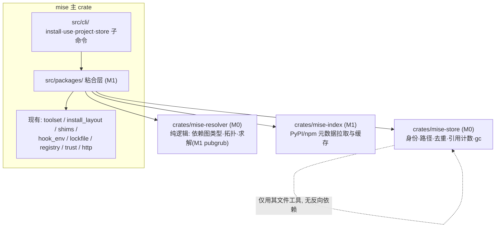

# ARCHITECTURE — mise 原生包管理（当前有效总览）

> 详细设计（用户已批准）：《mise-包管理架构设计.md》（仓库根）。本文件是开发过程中的现状快照，结构与详细设计一致，随实现推进更新。
> 决策索引：ADR-0001 四层架构与 crate 划分 · ADR-0002 解析器选型 · ADR-0003 CAS 存储+物化 · ADR-0004 安全与范围策略

## 组件图

依赖方向（硬约束，防循环）：`mise-resolver`（叶子，仅 petgraph）← `mise-store`、`mise-index` ← 主 crate `src/packages/` ← `src/cli/`。resolver 的生态标识用 `String`（"python"/"node"），带类型的 `Eco` 枚举住在 mise-store，glue 层负责转换——这样 resolver 保持零业务依赖，可独立跑差分测试。

## 各组件职责与关键接口

| 组件            | 职责（一句话）                                                                 | 关键接口（现状/计划）                                                                                                                                                            | 阶段    |
| --------------- | ------------------------------------------------------------------------------ | -------------------------------------------------------------------------------------------------------------------------------------------------------------------------------- | ------- |
| `mise-resolver` | 把"约束"变成"确定的具体版本集合"，纯逻辑                                       | `ResolvedGraph { nodes: Vec<ResolvedNode> }`、`install_order() -> Vec<String>`（拓扑，依赖在前）；M1 增 `solve(requests, metadata_provider, locked) -> ResolvedGraph`（pubgrub） | M0 起步 |
| `mise-store`    | 包身份 → 磁盘目录；下载产物校验落盘；跨项目去重与回收                          | `Eco/Platform/RuntimeId/Digest/PackageIdentity`；`Store::open/contains/unpack/add_ref/remove_ref`；`gc(&Store)`                                                                  | M0 起步 |
| `mise-index`    | 各生态注册表 API 客户端 + 元数据缓存（落 `~/.cache/mise/index/`）              | M1 定：`fetch_metadata(eco, name, version) -> PackageMetadata`（依赖声明、产物清单+哈希）                                                                                        | M1      |
| `src/packages/` | 粘合：解析→下载→落 store→物化→记锁；python/node 包后端                         | M1 定：`backend/python.rs`、`materialize/venv.rs`、lock v2 集成                                                                                                                  | M1      |
| `src/cli/`      | 命令面：install/use 扩展包语法；`project init/attach/ls/status`；`store ls/gc` | `python@3.10.14+numpy@4.2.2` 语法解析进 `cli/args`                                                                                                                               | M1/M3   |

## 技术栈清单

| 项                   | 选择                                        | 决策     |
| -------------------- | ------------------------------------------- | -------- |
| 语言                 | Rust（workspace 成员 crate）                | ADR-0001 |
| 求解算法             | pubgrub crate                               | ADR-0002 |
| python 版本/依赖语义 | pep440_rs + pep508_rs                       | ADR-0002 |
| node 版本语义        | node-semver                                 | ADR-0002 |
| 依赖图/拓扑          | petgraph（仓库已有）                        | ADR-0001 |
| 存储                 | `~/.local/share/mise/store/`，CAS + symlink | ADR-0003 |
| 压缩解包             | flate2 + tar（zip 随 M1 wheel 引入）        | ADR-0004 |
| 平台                 | 不做 Windows（macOS/Linux）                 | ADR-0003 |

## 数据流：`mise install python@3.10.14+numpy@4.2.2`（目标态，M1 落地）

1. CLI 解析出：语言请求 `python@3.10.14` + 包请求 `numpy@4.2.2` 绑定该运行时
2. 读取三层配置 → 合并 `[packages."python@3.10.14"]` 组内约束
3. 有 mise.lock 且与配置一致 → 直接按锁安装（跳过 4）
4. resolver 求解：index 提供元数据（numpy 4.2.2 的依赖声明、候选产物+哈希）→ 输出 ResolvedGraph（含传递依赖精确版本+digest）
5. 逐节点（拓扑序，可并行）：store.contains? 否 → 下载产物 → digest 校验 → unpack 进 store
6. 物化：生成 `.mise/venvs/python-3.10.14/`（site-packages 链接 → store；bin 入口 → shims）；store.add_ref(项目)
7. 写 mise.lock v2（整图+哈希）；未在 `[tools]`/`[packages]` 的提示 `mise use`

## 现状与进度

- M0（进行中，见 PLAN.md）：mise-store 与 mise-resolver 两 crate 的地基任务
- M1-M5：见 PLAN.md 里程碑索引，M0 验收后逐个细化落档
